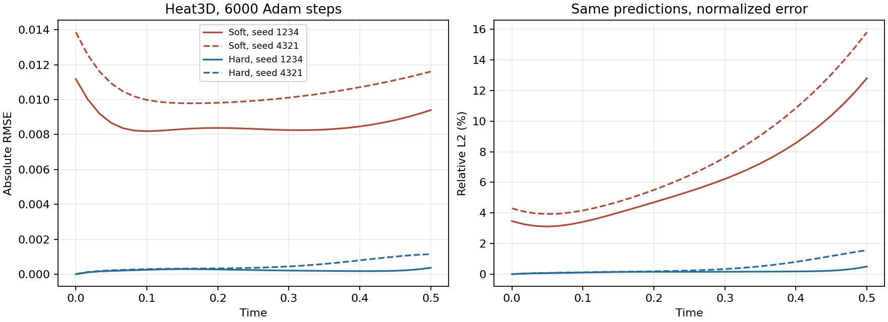

# Эксперименты точности, 13 октября 2026

Ветка `codex/model-accuracy`. Цель: выяснить причину ошибки последнего временного
слоя и проверить отключаемые способы улучшения модели на текущем стеке.
Результаты ниже получены настоящим обучением на Windows RTX 4070 Ti, а не моками.
Новые defaults автоматически не принимались.

Итого: **36 численных обучений, 192000 optimizer steps**, плюс три отдельные
256-шаговые калибровки памяти. Это не число пройденных unit-тестов:
часть численных запусков намеренно завершилась с failed quality gate.

## Протокол

Python 3.10.11, Torch 2.1.0+cu118, CUDA 11.8, Lightning 2.1.0, NumPy 1.26.4.
FP32, `float32_matmul_precision=highest`, TF32 выключен. Архитектура: три скрытых
слоя по 32 нейрона, Adam, начальный LR 0.001, PDE batch 128, фиксированные
1024 LHS-точки, если явно не указано иное. Контрольные seed: 1234 и 4321;
расширение heat3d: заранее выбранные 19, 2026, 73.

Область каждой пространственной координаты [0,1], время [0,0.5]. Оценка heat3d:
17³ пространственных точек × 31 момент = 152303 значения; heat2d: 41² × 31;
Burgers: 41 × 31. Эти сетки отличаются от обучающих. PDE RMSE измеряется на
2048 независимых случайных точках с holdout seed 20261013, также по временным bins.
Аналитическое решение используется только в оценке. `data.mat` не используется.

Во всех сравниваемых запусках диагностика норм градиентов включена каждые
200 шагов. Время обучения включает запуск файлового runner, подготовку,
диагностику и fit; это не чистое время CUDA kernels. Тёплый инференс измеряется
отдельно: 3 прогрева, 7 измерений, batch 2048, синхронизация CUDA.
Полный запуск predict занимает около 2.2–2.4 секунды и в этих маленьких задачах
в основном отражает запуск процесса, поэтому для сравнения forward используем
тёплое время на всей оценочной сетке.

Результаты до hard constraints получены на соответствующих коммитах адаптеров:
`b4ce1ff` (loss), `85acf6c` (scheduler), `a38bb26` (sampling);
hard и последующие сравнения — на `c3ba93f`. Рефакторинг бенчмарков `e731208`
сохраняет прежние восемь train/eval конфигураций в точности. Во время экспериментов
Windows checkout не обновлялся. `working_tree_dirty=true` объясняется прежними
неотслеживаемыми временными папками и установщиком Python; проверка `git diff`
и `git diff --cached` показала отсутствие изменений отслеживаемого кода.

Порог общей relative L2 остаётся 5%, max error 0.15, PDE RMSE 0.1,
IC/BC RMSE 0.05. Ошибка последнего слоя — отдельная диагностическая метрика,
сейчас она не входит в абсолютный quality gate. Поэтому «passed» не гарантирует
высокую точность последнего слоя. Не ослабляем пороги ради зелёного отчёта.

## Что изменилось в коде

* `LossPolicy`: именованные IC/PDE/BC, `EqualWeights` и `FixedWeights`.
  Невзвешенные компоненты и отключаемые нормы градиентов записываются отдельно.
  Нормы вычисляются без изменения накопленных `.grad` оптимизатора.
* Политика LR: прежний constant и отключаемый exponential, привязанный к шагам
  оптимизатора. Эффективный LR и recipe/version сохраняются.
* `SamplingPolicy`: фиксированный LHS и детерминированное обновление только
  PDE-точек на границе эпох. Локальный NumPy RNG, координаты и счётчик эпох
  сохраняются в состоянии datamodule; IC/BC и holdout не обновляются.
* Hard transform для совместимых начальных условий и полного прямоугольника
  с нулевым Dirichlet. Проверки применимости, производных и checkpoint contract.
* CUDA allocator profile: peak allocated/reserved за fit. Это память PyTorch,
  а не вся занятая GPU-память, включая драйвер и CUDA context.
* В бенчмарках независимые `GridPolicy`, `TrainingBudget`, `QualityPolicy`;
  PDE остаётся полиморфным объектом. Композиция адаптеров сохраняет критерии
  качества исходной задачи, в том числе пользовательские.

API с исполняемыми примерами: [API.md](API.md). Все новые стратегии opt-in;
прежние constant LR, единичные веса, fixed sampling и soft constraints сохранены.
`--checkpoint` файлового runner по-прежнему означает fine-tune весов с новым
оптимизатором. Проверенное восстановление отдельных optimizer/scheduler/sampler
state не означает, что CLI уже реализует полный resume произвольного шага.

## Скрининг heat3d

В таблице пара чисел всегда означает seed **1234 / 4321**, ошибки L2 в процентах.
Каждая стратегия проверяется отдельно, без смеси нескольких новых настроек.

| Режим | Шаги | Общая L2, % | Последняя L2, % | PDE RMSE | Обучение, с |
|---|---:|---:|---:|---:|---:|
| Контроль | 6000 | 4.68 / 5.76 | 12.80 / 15.81 | 0.0313 / 0.0327 | 55.87 / 55.78 |
| BC weight 3 | 6000 | 6.47 / 5.69 | 19.12 / 11.11 | 0.0369 / 0.0405 | 56.20 / 56.25 |
| BC weight 10 | 6000 | 4.32 / 7.17 | 7.52 / 10.61 | 0.0423 / 0.0550 | 56.33 / 56.19 |
| Exponential LR → 0.1 начального | 6000 | 9.05 / 11.22 | 19.75 / 28.18 | 0.0444 / 0.0553 | 56.65 / 56.48 |
| Constant LR, двойной бюджет | 12000 | 4.61 / 4.04 | 11.56 / 9.38 | 0.0198 / 0.0216 | 110.67 / 109.69 |
| Resampled LHS 1024, каждую эпоху | 6000 | 5.40 / 7.11 | 10.75 / 23.31 | 0.0240 / 0.0391 | 56.81 / 56.80 |
| Fixed LHS 4096 | 6000 | 5.22 / 5.30 | 11.23 / 12.86 | 0.0252 / 0.0270 | 56.28 / 55.96 |
| Hard IC + box Dirichlet | 6000 | **0.122 / 0.316** | **0.494 / 1.564** | **0.00514 / 0.00795** | 76.72 / 76.33 |

### 1. Усиление штрафа границ

BC weight 10 уменьшил BC RMSE до 0.00958/0.00848 и улучшил последний слой
на обоих seed. Но IC RMSE вырос до 0.01521/0.02409, PDE residual тоже вырос;
общая L2 на seed 4321 ухудшилась. Простое «сильнее прижать границу» не даёт
устойчивого улучшения всей задачи. Weight 3 также не подтвердился.

Это согласуется с конкуренцией компонентов оптимизации, но нормы градиентов
сами по себе не доказывают конфликт направлений: cosine similarity не измеряли.
В конце контроля невзвешенные PDE gradient norms 0.097/0.185 против
BC 0.029/0.038 и IC 0.023/0.045. При weight 10 нельзя сравнивать невзвешенную
BC-норму с PDE как реальный вклад: оптимизатор получает BC gradient × 10.
Данные оставлены в `numerical-reports/gradient-norms-001.json`.

### 2. Снижение LR и увеличение бюджета

Exponential decay с первого шага до 0.1 ухудшил оба seed. Рабочая гипотеза:
скорость уменьшилась до того, как сеть достаточно выучила пространственную форму.
Это отрицательный результат для конкретного расписания, а не доказательство
бесполезности scheduler вообще. Следующий разумный тест — отложенное снижение
после основной стадии Adam, отдельно от изменения бюджета.

12000 шагов с constant LR снизили независимый residual на обоих seed,
оба запуска прошли общие quality gates. Однако последняя L2 всё ещё 9–12%,
а время почти удвоилось. Увеличение длительности помогает, но не устраняет
наблюдавшийся дефект эффективно.

### 3. Обновление и плотность PDE-точек

Random resampling не улучшился устойчиво: первый seed снизил PDE/final error,
второй ухудшился. Fixed 4096 уменьшил PDE и final error на обоих seed, но общий
порог 5% не прошёл ни один. Эти варианты не принимаются в defaults.

Размер batch остался 128, поэтому четыре раза больше хранимых точек не означает
четыре раза больше вычислений за optimizer step. Более того, длина CombinedLoader
и цикл IC/BC меняются вместе с размером набора. Это не эксперимент, изолирующий
только геометрическую плотность при совершенно одинаковой последовательности
батчей. Resampling также требует reload dataloaders и может менять shuffle.
Не переносим отрицательный вывод на residual-adaptive sampling, которого здесь нет.

Отдельная калибровка по 256 шагов дала одинаковый allocator peak для трёх
режимов: 18471424 allocated bytes и 23068672 reserved bytes. Это короткая
калибровка памяти, **не измерение пика прежних 6000-шаговых запусков**.
Точки хранятся на CPU, размер CUDA batch не меняется.

### 4. Точные начальные и граничные условия

Преобразование имеет вид

```text
u(x,t) = g(x) + τ(t) B(x) N(x,t)
B(x) = ∏ 4 ξᵢ(1 − ξᵢ)
```

`g` — заданное пользователем начальное условие; `τ` — нормированное время.
На t=t0 получается g, на любой грани B=0. При совместимом g все нулевые границы
выполняются одновременно, включая рёбра и углы. Не используется точная
временная зависимость решения. IC/BC штрафы исключаются; остаётся PDE loss.

Для heat3d улучшились не только границы. Последняя interior RMSE уменьшилась
с 0.00680/0.00788 до 0.000438/0.001386. Для моды
sin(πx)sin(πy)sin(πz) проецируем предсказание на неё, затем отдельно измеряем
ошибку амплитуды и остатка пространственной формы:

| Последний момент, % | Soft 1234 / 4321 | Hard 1234 / 4321 |
|---|---:|---:|
| Ошибка амплитуды | 3.25 / 1.71 | 0.38 / 1.44 |
| Ошибка формы относительно нормы эталона | 12.38 / 15.72 | 0.31 / 0.61 |

То есть исходная проблема в этих запусках связана главным образом с формой,
а не с неверной скоростью затухания основной моды. Hard transform одновременно
меняет представление решения и убирает конкурирующие IC/BC loss. Этот эксперимент
не разделяет влияние этих двух факторов и не доказывает, что причина только BC.
Для разделения понадобятся отдельные hard-only-BC/hard-only-IC абляции.

Цена при одинаковых 6000 шагах: обучение примерно +37%, тёплый инференс
46.5–46.9 ms против около 20 ms контроля на 152303 значениях.
Дополнительные вычисления g и B остаются в forward. На predict не включаем
autograd без необходимости; при train производные преобразования сохраняются.

Дополнительный тест цены достижения качества: при **3000 шагах** soft дал
общую L2 9.16/11.39%, последнюю 22.17/26.55% за 29.70/29.58 секунды.
Hard — общую **0.338/0.357%**, последнюю **0.889/1.227%** за 40.02/39.72 секунды.
Таким образом, hard на половинном бюджете качественнее soft даже на 6000
и 12000 шагах. 40 секунд против 56 или 110 — практический выигрыш времени
для этих двух seed, хотя одинаковое число шагов hard выполняет медленнее.
Это сравнение дискретных бюджетов, не измерение первого пересечения quality
threshold: аналитические метрики не использовались для ранней остановки.

### Подтверждение heat3d на пяти seed

Та же архитектура, 6000 шагов, одинаковые попарные soft/hard настройки.
Все seed заданы заранее; показываем каждый, а не выбираем лучший.

| Seed | Soft общая L2, % | Hard общая L2, % | Soft последняя L2, % | Hard последняя L2, % |
|---|---:|---:|---:|---:|
| 1234 | 4.682 | 0.122 | 12.803 | 0.494 |
| 4321 | 5.756 | 0.316 | 15.808 | 1.564 |
| 19 | 4.907 | 0.432 | 13.711 | 1.475 |
| 2026 | 6.655 | 0.369 | 11.662 | 1.632 |
| 73 | 5.596 | 0.133 | 13.882 | 0.497 |
| **Медиана** | **5.596** | **0.316** | **13.711** | **1.475** |
| **Худший** | **6.655** | **0.432** | **15.808** | **1.632** |

Hard улучшил общий и последний L2 на всех пяти seed и прошёл все текущие
численные gates в каждом запуске; soft общий gate прошёл на двух из пяти.
Медианное время обучения 56.32 → 76.58 s (+36%), тёплого инференса
19.43 → 46.87 ms (×2.41). Это подтверждённое улучшение данного heat3d benchmark,
не утверждение о любой PDE и любых начальных данных. Пяти-seed проверка
всех PDE и комбинаций адаптеров в TASK-14 остаётся незавершённой.

График первых двух попарных запусков отдельно показывает абсолютную и
нормированную ошибку: большой рост relative L2 усиливается затуханием эталона,
хотя небольшое увеличение абсолютной ошибки к концу тоже присутствует.



Поддержана только совместимая область с полными однородными Dirichlet faces,
без variable parameters и пользовательского output transform. Neumann/Robin
и неполные/неоднородные границы этим адаптером не поддерживаются. Проверка g
на дискретной сетке не является доказательством совместимости произвольного
callback на непрерывной границе. FP32 sin(π) оставляет остатки порядка 10⁻⁸.

## Переносимость: heat2d и forced Burgers

Каждый режим: 3000 шагов, те же два seed, одинаковые сетки и holdout.

| PDE / режим | Общая L2, % | Последняя L2, % | PDE RMSE | Обучение, с |
|---|---:|---:|---:|---:|
| heat2d soft | 2.047 / 2.122 | 4.126 / 4.874 | 0.0233 / 0.0211 | 27.14 / 26.77 |
| heat2d hard | **0.155 / 0.176** | **0.510 / 0.470** | **0.00627 / 0.00940** | 30.96 / 30.82 |
| Burgers soft | 0.287 / 0.547 | 0.408 / 0.767 | 0.00774 / 0.01008 | 24.45 / 24.76 |
| Burgers hard | 0.075 / 0.624 | 0.154 / 1.516 | 0.00290 / 0.01725 | 24.02 / 24.19 |

Оба heat2d улучшились. На Burgers seed 1234 улучшился, 4321 ухудшился,
хотя оба режима проходят абсолютные quality gates. Для плохого hard Burgers
ошибка пространственной формы уменьшилась с 0.359% до 0.124%, а амплитуды
увеличилась с 0.678% до 1.511%. Таким образом, точные границы не гарантируют
правильную амплитуду нелинейного решения при фиксированном бюджете оптимизации.

На основании этого результата проверил новую гипотезу: seed 4321 может требовать
больше оптимизации амплитуды. Удвоил бюджет **обоих** режимов до 6000 шагов.
Soft получил общую L2 0.192%, последнюю 0.310%, PDE RMSE 0.00526 за 46.73 s;
hard — **0.0560%**, **0.138%**, **0.00277** за 45.82 s. Hard теперь лучше контроля.
Это поддерживает объяснение через недостаточную сходимость на 3000 шагах,
но не доказывает его единственность и не заменяет проверку других seed.

Тёплый инференс heat2d вырос с 6.5–7.2 до 14.1–15.3 ms, Burgers с
0.25–0.26 до 0.45 ms. Advection не проверяли с этим hard-адаптером:
у задачи ненулевая входная и отсутствующая выходная граница, он неприменим.
Контрольная математика advection остаётся покрыта CPU-тестами.

## Неожиданности и технические трудности

1. Lightning создаёт iterator и делает prefetch до `on_train_epoch_start`.
   Обновление координат в этом hook могло оставить первые батчи со старыми
   точками. Перенёс refresh до создания loader iterator с явным reload.
2. Несовпадение частоты диагностик и CSV logging могло скрывать step-метрики
   короткого запуска. Логирование проверено реальным 60-шаговым smoke;
   нормы пишутся и по шагам, и агрегированно по эпохам.
3. Проверка только суммы train loss вводит в заблуждение. BC weight 10 способен
   улучшить границы и последний слой, одновременно ухудшая IC/PDE и общую L2.
4. «Passed» и «лучше контроля» различаются. Burgers hard 4321 проходит пороги,
   но ухудшает качество относительно soft. Порог последнего слоя нужно обсуждать
   отдельно, не выдавать текущий global gate за контроль этого слоя.
5. Жёсткое преобразование делает checkpoint зависимым от начальной функции.
   Сохраняем constraint kind и SHA `functions.py`, несовместимое применение
   checkpoint отклоняем, чтобы не получить физически другое поле молча.
6. Память GPU оказалась почти одинаковой у fixed/resampled/dense при постоянном
   batch: увеличился CPU-набор координат, а не CUDA batch. Reserved memory
   отражает allocator buckets, а не точный объём активных тензоров.

## Воспроизведение

Команды выполняются PowerShell из `C:\Projects\pinn-runner`, исключительно на
Windows. Перед каждой командой проверяется текущая директория. Output-dir должен
быть новым: существующие результаты не перезаписываются.

```powershell
& '.\.venv\Scripts\python.exe' scripts/benchmark_solutions.py --profile reference --cases heat3d --steps 6000 --seeds 1234 4321 --gradient-norm-every 200 --output-dir numerical-reports\control-new
```

Один экспериментальный флаг на запуск:
`--boundary-weight 3`, `--boundary-weight 10`, `--lr-final-ratio 0.1`,
`--resample-every-epochs 1`, `--collocation-points 4096`,
`--constraints hard_initial_dirichlet`. Отдельный контроль длительности:
`--steps 12000`, без scheduler. Флаги можно компоновать, но такая композиция
требует отдельной приёмки; успешность компонентов не доказывает её успешность.

Имена каталогов в CSV совпадают с именами локальных/Windows `numerical-reports`.
Полные JSON, checkpoint, MAT, CSV обучения и логи остаются там; компактные
результаты сохраняются в [experiments/2026-10-13.csv](experiments/2026-10-13.csv).

## Следующие проверки

* Adam → L-BFGS с фиксированными точками и честным учётом closure evaluations:
  проверить остаточную ошибку амплитуды, прежде всего на Burgers.
* Отложенное снижение LR вместо уже отвергнутого раннего exponential decay.
* Абляции hard IC и hard BC отдельно; затем комбинации адаптеров.
* Пять seed для всех применимых PDE, median/worst, временные метрики,
  скорость и память; отдельная цена достижения заданной точности.
* Не начинать causal/time-window сложность только потому, что ошибка выросла
  к последнему слою: здесь есть сильные альтернативные объяснения.
* Обновление Torch/Lightning остаётся отдельной отложенной задачей после
  подтверждения алгоритмического baseline на текущем стеке.

Backlog содержит результаты завершённых скринингов и оставшиеся задачи.
Общий этап принятия standard defaults (TASK-14) пока не завершён.

## Проверки реализации

Итоговый `python scripts/check.py --full` на Mac: Ruff, форматирование, strict
mypy (47 source files), **233 passed**, 82.93 s. Это полный CPU-набор, включая
e2e; он не заменяет численную CUDA-приёмку. Отдельно выполнялись профильные
тесты компонентов и короткие реальные 60-шаговые CPU smoke для логирования,
scheduler checkpoint, обновления точек и hard train/predict. Smoke проверяет
маршрут исполнения, а не достижение численной точности.

Windows после fast-forward до `1246868`: CUDA hardware acceptance **5 passed**,
0 failed/skipped, 15.49 s; отдельно **41 passed** в профильном наборе
loss/rate/sampling/hard constraints/solution benchmarks. Полный CPU-набор
на Windows в этот блок не запускался. Все SSH-сессии после получения результатов
закрыты; команды, кеши и результаты оставались в `C:\Projects\pinn-runner`.
