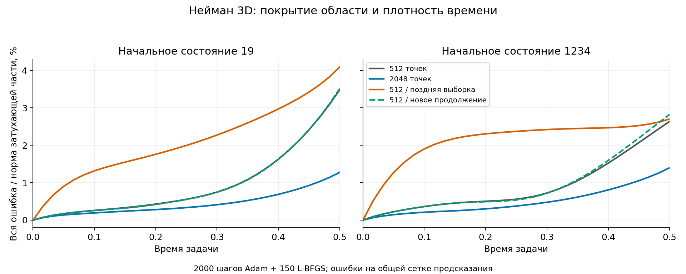
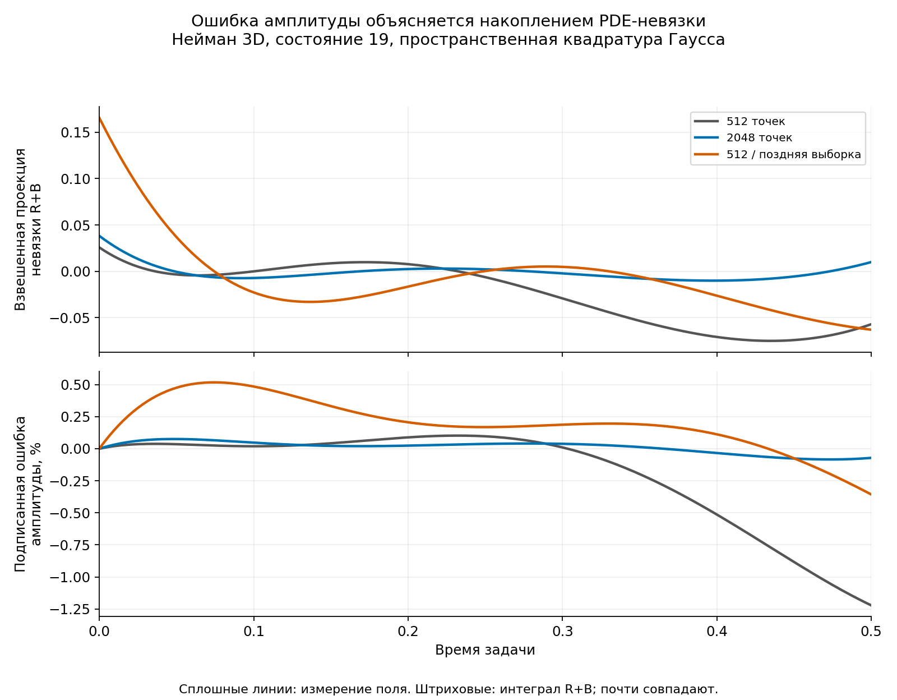
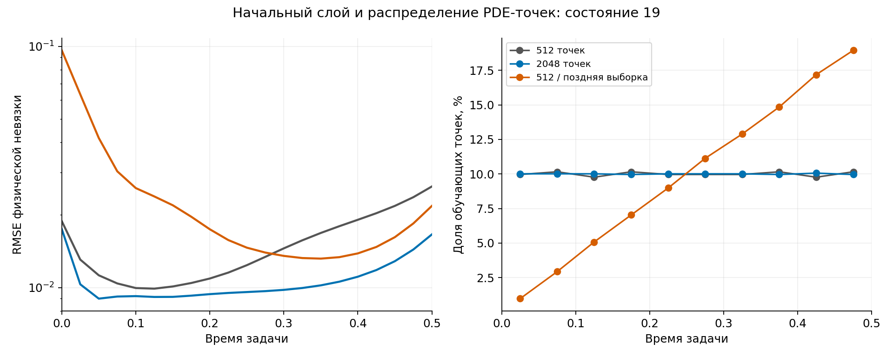

# Точность позднего слоя и стоимость точных ограничений: 15 октября 2026

Итоговый отчёт завершённого блока TASK-21/TASK-26: 16 основных обучений,
пятисостоянийное сравнение и независимая проверка квадратуры завершены.
Разработка — Mac M1, CUDA — только Windows RTX 4070 Ti, Torch 2.1.0+cu118,
FP32, матричный TF32 выключен. Зависимости не обновлялись.

## Что проверяем

У точных условий Неймана/Робина границы выполняются примерно до округления,
но это не делает невязку PDE нулевой. В предыдущем Неймане3D ошибка последнего
слоя относительно затухающей части оставалась2,6–3,5%. Проверяем отдельно:
увеличение числа PDE-точек, усиление поздних времён и эквивалентное удешевление
продолжения граничных данных. Условия приёмки не подгоняются под результаты.

Все точные решения остаются в оценке. Обучение получает только начальное поле,
граничные данные и исходное уравнение; `data.mat` не нужен.

## Изменения реализации

- `training.hard_lifting: expanded` — отдельный способ вычисления продолжения,
  независимо от `hard_execution`, выбирающего проекцию сети. Контроль recursive сохранён.
- `collocation.time_power` — отключаемая степенная плотность времени LHS.
  Начальные/граничные точки и сетка предсказания не меняются; L-BFGS фиксирует
  уже подготовленные физические точки до вызовов функции оптимизатора.
- Независимый модальный баланс, в том числе коэффициент из g/f/h без полного
  эталонного решения; пространственная квадратура Гаусса и сгущение времени.
- Прямые PDE-проверки начального/последнего слоёв и сверка MAT-меток с моделью.
  Контрольный тест с искусственным сдвигом времени обнаруживает перестановку.
- Исправлены физические интервалы независимой выборки и явные контрольные
  параметры бенчмарков. Единичные старые PDE-точки сохранены побитово.

## Математический смысл

Продолжение строилось рекурсивно. Для пары граней оси i обозначим через H_i
продолжение предписанных следов, через P_i — продолжение следов произвольной
функции, а Q_i=I−P_i. Тогда точное раскрытие рекурсии:

$$
A_i=Q_iA_{i-1}+H_i,\quad A_0=0,\qquad
A_d=\sum_{i=1}^{d}\left(\prod_{j=i+1}^{d}Q_j\right)H_i.
$$

Сумма вычисляется непосредственно по граням и пересечениям с общей геометрией
одного вызова. Линейность позволяет обработать текущий и начальный момент
одним поточечным пакетом. Физическое поле и PDE остаются прежними:

$$
u_\theta=g+A[h(t)-h(t_0)]+\tau QN_\theta.
$$

Доказательство требует постоянных коэффициентов граничных операторов,
осевых базисов, гладкости и совместимости данных. Все нужные смешанные
производные остаются в графе; значения сети между шагами не кэшируются.
Полный вывод и ограничения: [robin-lifting-optimization.md](robin-lifting-optimization.md).

Для ошибки вдоль собственной формы φ теплового оператора получено:

$$
a_e'+\lambda a_e=R+B,\qquad
\rho(t)=\rho(t_0)+\int_{t_0}^{t}e^{\lambda(s-t_0)}[R(s)+B(s)]\,ds.
$$

R — проекция PDE-невязки, B — измеренный дефект граничного оператора,
ρ — подписанная относительная ошибка амплитуды. Большая поздняя относительная
ошибка может появляться при небольшой абсолютной ошибке затухающего сигнала.
Но она также содержит ортогональные пространственные искажения: одной амплитуды
недостаточно. Вывод через формулу Грина и вариант без эталона:
[modal-error-balance.md](modal-error-balance.md).

## Покрытие области и плотность времени

Нейман 3D, состояния19/1234, сеть32×32×32,2000Adam+150L-BFGS, размер пакета Adam128.
При2048точках увеличивается полный набор L-BFGS, поэтому это одинаковое число
шагов, но не одинаковое число посещений PDE-точек.

| Точки / время | Состояние | Общий L2 | PDE RMSE | Последний слой / мода | Обучение | Строгая проверка |
|---|---:|---:|---:|---:|---:|---|
|512 / равномерно|19|0,1120%|0,01801|3,4866%|361,76с|пройдена|
|2048 / равномерно|19|0,05203%|0,01222|1,2780%|355,51с|пройдена|
|512 / поздние времена|19|0,2619%|0,02942|4,0961%|357,73с|не пройдена|
|512 / равномерно|1234|0,1044%|0,01562|2,6423%|357,22с|пройдена|
|2048 / равномерно|1234|0,05847%|0,01219|1,4012%|357,47с|пройдена|
|512 / поздние времена|1234|0,3021%|0,03682|2,7058%|см. CSV|не пройдена|

Рост памяти244,18→924,48МиБ — существенная цена большего полного набора.
Почти одинаковое время не означает одинаковую работу: всего посещено примерно
413тыс.против881–887тыс.PDE-точек. Маленькая сеть на этой GPU эффективно
обрабатывает больший пакет; это не обещание такого же результата на всех моделях.

Временная плотность при p=1 равна2s вместо1. Это изменение веса функционала,
а не прозрачное ускорение. Даже с точным начальным значением нужна правильная
производная по времени в начале: она задаётся PDE. Слабое покрытие начала
может мешать всей динамике. Сравнение точных временных слоёв проверяет эту
гипотезу отдельно; из одной красивой формулы нельзя объявить позднее усиление
успешным. Протокол: [temporal-sampling-experiments.md](temporal-sampling-experiments.md).

## Что удалось удешевить

На одинаковых сохранённых весах и точках, с обратным порядком трёх повторений,
пакет512, медианное время невязки и обратного прохода:

| Задача | Рекурсия, мс | Раскрытая сумма, мс | Снижение времени |
|---|---:|---:|---:|
| Нейман 2D | 41.38 | 36.95 | 10.70% |
| Робин 2D | 42.89 | 39.85 | 7.10% |
| Нейман 3D | 152.47 | 119.21 | 21.81% |
| Робин 3D | 158.23 | 139.51 | 11.83% |
| Смешанные грани 3D | 154.34 | 126.32 | 18.15% |

Это повторные измерения чистой PDE-невязки, код `665fc17`, три чередующихся
повторения на одинаковых весах и точках. В раннем отдельном измерителе ошибочно
суммировались физическое поле и невязка: API возвращает оба. Исправлен отбор
имён уравнений, добавлен тест с ненулевым точным полем и нулевой невязкой;
все приведённые здесь времена пересняты. Основное обучение и его независимые
метрики PDE этим дефектом не затронуты. Максимальные различия поля 4,77·10⁻⁷,
невязки 2,87·10⁻⁶, градиентов весов 7,76·10⁻⁸.

В 1D общий пакет сначала дал регрессию; прямое одномерное продолжение устранило
её: чистая PDE с обратным проходом быстрее на 2,42% для Неймана и 2,75% для Робина.

Первый полный Нейман 3D при512точках: обучение361,76→281,50с и357,22→281,57с,
тёплое предсказание22599точек0,285→0,224с. Качество близкое, но не побитовое:
изменение порядка FP32-операций может менять выбор шага L-BFGS.
Это ещё не кривая времени первого достижения заданной точности.

## Пятисостоянийная проверка и решение по умолчанию

Пять парных состояний 19/1234/4321/2026/73, 2048 точек, Adam 2000 + L-BFGS 150:
все десять моделей прошли прежнюю строгую проверку. Медианное обучение
355,51 → 280,08 с (−21,22%); тёплое предсказание 0,28517 → 0,22436 с (−21,33%).
Память практически прежняя. Однако медиана общей ошибки ухудшилась на 1,64%,
а последнего слоя — на 6,93%. Заранее заданное требование «медианы не хуже»
не выполнено. Поэтому `hard_lifting: recursive` остаётся по умолчанию,
`expanded` включается явно. `constraints: soft` и `time_power: 0` также сохранены.
Это решение не означает неверность алгебры: порядок FP32-операций влияет на
траекторию оптимизации, особенно выбор шагов L-BFGS.

## Метрики и неожиданные наблюдения

Ошибка всей температуры, ошибка относительно слабого сигнала и ошибка одной
проекции — разные показатели. Для состояния19 усиление позднего времени может
уменьшить ошибку выбранной проекции в конце, одновременно увеличив полную
ошибку и PDE-невязку. Поэтому одного удачного коэффициента недостаточно.

Равные веса сеточных точек отличаются от объёмного интеграла. В3Dсетке9³
53%точек лежат хотя бы на одной грани; в непрерывном объёмном интеграле грани
имеют нулевой объём. Это объясняет, почему дополнительная квадратура Гаусса
может дать другие значения модальных ошибок. Она не заменяет задним числом
общую метрику или пороги: оба определения публикуются отдельно.

## Проверки и границы вывода

- Полный Mac: **445 CPU-тестов, 227,63 с**, Ruff, format, strict mypy (82 исходных файла).
- Windowsпрофиль:115прошедших,203,81с;87CUDA-сценариев и28CPU-проверок/диагностик.
- Отдельный профиль выборки:14прошедших,26,14с, включая2CUDA-файловых сценария.
- Аппаратная приёмка `check_backend.py`: **8 тестов, 21,31 с**.
- Финальные профильные проверки Windows: **38 тестов, 6,73 с** (24 CUDA и 14 CPU).

CUDA-задания выполнялись последовательно отдельными SSH-процессами. Пока они
обучали модели, на Mac шли доказательства, реализация, CPU-проверки и отчёты.
Среда Windows не обновлялась; рабочая директория и временные пути — строго внутри
C:\Projects\pinn-runner. Эти результаты не являются проверкой LinuxDocker.

Численный вывод ограничен гладкими тепловыми задачами и этой GPU. Физические
коэффициенты граничных операторов постоянны; параметры семейства и смешанные
Дирихле/Робин не добавлены. Другой базис для почти Дирихле выведен только как
будущая гипотеза: [robin-basis-conditioning.md](robin-basis-conditioning.md).
Он меняет параметризацию конечной сети и требует отдельных опытов.

Исходные измерения: `experiments/2026-10-15-robin-study.json`; CSV: `experiments/2026-10-15-robin-study.csv`. Файлы моделей/журналы
остаются в numerical-reports Windows. Ни провалы, ни дорогие варианты не исключаются.

## Проверка меток и объяснение позднего слоя

У всех 16 моделей непосредственно сверены 23 328 точек начального и последнего
слоёв сохранённых MAT-файлов, плюс до 128 случайных точек на модель.
Максимальное расхождение с вычислением модели — 7,16·10⁻⁷: признаков сдвига
временной метки в этих артефактах нет. Проверка учитывает реальный формат
пространственной сетки × вектора времени, а не предполагает плоские столбцы.

Для состояния 19 невязка точно при начальном времени: равномерные 512 точек
0,01885; равномерные 2048 — 0,01747; поздняя плотность — **0,09619**.
При p=1 первая десятая времени получила всего 5 из 512 точек вместо 51.
Точное начальное значение не обеспечивает правильную начальную производную:
это поддерживает гипотезу недостаточного покрытия ранней динамики.

Баланс ошибки по собственной форме выполняется до примерно 10⁻⁷.
Сгущение временной квадратуры 81 → 161 уменьшило ошибку восстановления
коэффициента 5,66·10⁻⁶ → 1,54·10⁻⁶. Переход пространственной квадратуры
13 → 17 узлов практически не меняет результат. Коэффициент, рассчитанный
только из начальных/граничных данных и источника, совпадает с вариантом
по аналитическому решению примерно до 2·10⁻¹⁴.

## Следующая проверяемая оптимизация

Изолированный прототип ограничил **конечный обратный проход** только весами:
`autograd.backward(loss, inputs=tuple(model.parameters()))`. Координаты продолжают
требовать производных при построении PDE; отключать `requires_grad` у них нельзя.
Математически нам нужна производная функционала по весам, а накопление
дополнительного градиента функционала по входным координатам для шага оптимизатора
не требуется. На одной фиксированной модели CUDA градиенты всех весов совпали
побитово; медианы 152,04 → 121,25 мс для recursive и 117,96 → 104,38 мс для expanded.
Это **прототип**, без шагов оптимизатора и интеграции с Lightning/L-BFGS.
В рабочее обучение он не включён. Следующий блок должен проверить интеграцию,
эквивалентность градиентов и качество полных обучений.

Сравнение времени первого достижения точности остаётся открытым: итоговые
метрики после одинакового числа шагов не заменяют кривую обучения.

## Дополнительная проверка примерно одинакового времени

После измерения ускорения заранее увеличен бюджет expanded до 2500 Adam +
190 L-BFGS, чтобы использовать примерно те же 355–357 с, что контроль
recursive при 2000 + 150. Получены две законченные пары, обе прошли строгую
проверку; это предварительный опыт, а не пятисостоянийная приёмка.

| Состояние | Обучение: контроль → expanded | Общий L2 | Последний слой L2 | PDE RMSE |
|---|---:|---:|---:|---:|
| 19 | 355.51458 → 351.33293 с | 0.05203 → 0.04760% | 0.06785 → 0.05932% | 0.01222 → 0.01128 |
| 1234 | 357.47013 → 351.56917 с | 0.05847 → 0.05620% | 0.07439 → 0.06941% | 0.01219 → 0.01071 |

При использовании сэкономленного времени общая ошибка и ошибка последнего слоя
стали меньше в обеих парах. Тёплое предсказание — 0,2250/0,2265 с для 22 599 точек.
Это поддерживает полезность ускорения, но не отменяет отрицательный исход заранее
заданной пятисостоянийной проверки с одинаковым числом шагов. Полноценное время
первого достижения точности и пять пар при равном времени ещё не измерены.

Всего завершено **18 обучений**: 16 основных и 2 дополнительных.
На точке остановки очередь опытов завершена; дополнительных заданий не оставлено.
