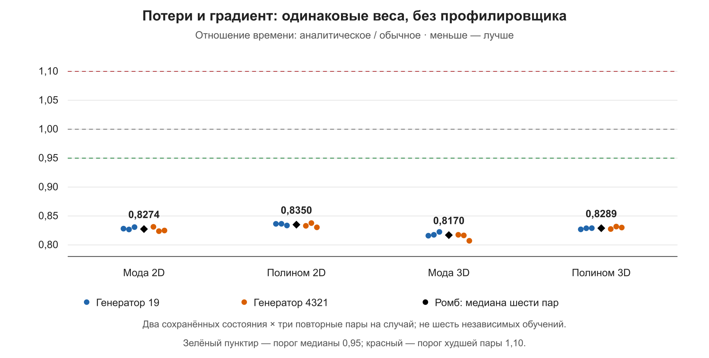

# TASK-21: неизменяемые веса, стоимость без профилировщика

## Результат и границы

Серия timing014 завершена: 48/48 отдельных процессов, 24 пары, 8 сохранённых состояний. Ноль обновлений весов. Общий заранее заданный результат сравнения: `True`.

Это стоимость потерь/градиента и предсказания на фиксированных входах. Нового обучения не было; точность PDE нового обучения здесь не утверждается. Исходные веса взяты из проверенных analytic011/012. Базис и алгоритм оптимизации не менялись; defaults прежние.

## Парное сравнение

Значения — analytic/autograd, медианы шести пар на случай: два состояния генератора × три повтора. Меньше единицы означает меньшую стоимость.

| Случай | Потери/градиент, медиана | Худшая пара | Предсказание 128 | Предсказание 2048 | Пик выделенной, худшая пара | Все критерии |
|---|---:|---:|---:|---:|---:|---|
| Мода 2D | 0.82743 | 0.83126 | 1.00671 | 1.00723 | 0.99432 | Пройдены |
| Мода 3D | 0.81698 | 0.82251 | 1.00738 | 1.01276 | 0.99238 | Пройдены |
| Полином 2D | 0.83502 | 0.83777 | 0.99928 | 1.00586 | 0.99434 | Пройдены |
| Полином 3D | 0.82891 | 0.83172 | 0.99961 | 1.00529 | 0.99240 | Пройдены |

Зарегистрированные пороги: медиана потерь/градиента ≤0,95; худшая пара ≤1,10; медиана предсказания при обоих пакетах ≤1,10; худшее отношение выделенной памяти ≤1,10. Пороги после результата не менялись.

Медианное снижение стоимости: мода 2D 17,26%, полином 2D 16,50%, мода 3D 18,30%,
полином 3D 17,11%. Это снижение времени конкретной неизменной операции, а не
ускорение нового обучения или всего приложения.

## Абсолютные измерения

Стоимость одного вызова: медиана девяти средних T/n по блокам внутри процесса; ниже — медиана этих оценок шести процессов каждого правила. Это отдельная статистика: её отношение не обязано совпасть с медианой парных отношений выше.

| Случай | Потери/градиент обычное, мс | Аналитическое, мс | Прогретое предсказание 128, мс (обычное/аналитическое) | Предсказание 2048, мс |
|---|---:|---:|---:|---:|
| Мода 2D | 8.0834 | 6.6950 | 42.9401 / 43.2304 | 3.3381 / 3.3552 |
| Мода 3D | 11.1149 | 9.0720 | 51.8441 / 52.2268 | 4.0479 / 4.1060 |
| Полином 2D | 8.9211 | 7.4529 | 46.4083 / 46.3095 | 3.6114 / 3.6193 |
| Полином 3D | 12.6052 | 10.4492 | 57.5046 / 57.3300 | 4.5012 / 4.5198 |

Предсказание выполнялось на 8193 точках; последний пакет 128/2048 содержит одну точку. Потери/градиент — на 1024 точках. Для выбранного представления предсказание отключает координатный граф: само обратное правило не меняет последовательность вычисления значений. Небольшой разброс времени не следует выдавать за новую оптимизацию предсказания.

## Независимые контроли и полнота

Все 48/48 проверок неизменности весов и 48/48 проверок исходных файлов успешны. Все процессы без профилировщика, шесть потоков CPU. В каждой паре совпали state/точки/предсказание. Пакеты 128/2048 отдельно прошли сравнение значений rtol 2e-4, atol 5e-6.

Максимальная разница потерь: 7.95808e-12; компоненты градиента: 1.66183e-08; относительная L2-разница: 3.36975e-05. Прежние допуски независимого автоградиентного контроля сохранены. Максимумы могут относиться к разным процессам; допуск проверяется отдельно в каждом контроле.

Записано 3256.23 с измеряемых блоков; суммарная длительность отдельных дочерних процессов 3391.04 с. Максимальная относительная MAD девяти блоков среди всех групп 1.9580%, медианная 0.3250%. Это описательная статистика, не доверительный интервал независимых обучений.

## Холодная подготовка и память

`cold_ready_seconds` начинается перед импортами сценария и заканчивается первым завершённым предсказанием; старт интерпретатора и запись MAT в него не входят. Файловые/драйверные кеши между процессами не сбрасывались. Это диагностика свежего процесса, не полный публичный файловый end-to-end.

| Случай | Подготовка до готового предсказания, с (обычное/аналитическое) | Первое предсказание, мс |
|---|---:|---:|
| Мода 2D | 2.1722 / 2.1811 | 67.0518 / 67.6294 |
| Мода 3D | 2.1793 / 2.1699 | 67.9199 / 67.7482 |
| Полином 2D | 2.1713 / 2.1737 | 67.0417 / 67.0601 |
| Полином 3D | 2.1882 / 2.1869 | 67.7903 / 67.1901 |

Пики памяти относятся к распределителю Torch после разогрева. Зарезервированная память включает кеш после контроля обеих ветвей, а не только минимальную потребность выбранной ветви. Эти величины не равны общей занятой памяти видеокарты и не показывают окупаемость нового кеша; новый кеш не вводился.

## Источники и выполненные проверки

Код измерителя: `7b81d0851b2437e049854cc5aefc19a2adc68bc2`; перспективный протокол: `1507f08a30e078c1fcb8a5bd3e12758f4efe2031`, `docs/experiments/2026-10-18-frozen-timing-protocol.json`. Полный CPU перед запуском: 837 passed за 294,56 с, Ruff/format/strict mypy; профильные 48 passed. Новый backend обучения не вводился.

Штатные collect/compare проверили полноту и целостность: `numerical-reports/timing014-compact`. Подробные отчёты и журналы Windows: `C:\Projects\pinn-runner\.gpu-jobs\timing014\r`. Источники весов в протоколе; сами веса на Mac не копировались.

[48 измерений](experiments/2026-10-18-timing014-summary.csv), [24 пары](experiments/2026-10-18-timing014-pairs.csv), [разброс блоков](experiments/2026-10-18-timing014-block-dispersion.csv), [контроли и среда](experiments/2026-10-18-timing014-validation.json).

## Связь с предыдущими результатами

Нативная трасса показывала сокращение 656→534 ядер в сопоставимом вызове 2D; она не была измерением ускорения. Настоящая серия отдельно проверяет стоимость без Nsight. Счётчики 011/012 показывают, что меньшая стоимость операции и меньшее число оценок L-BFGS — разные эффекты. Их нельзя суммировать как проценты или целиком переносить на время до заданной точности.

Полная приёмка TASK-21 остаётся открытой: отдельное разложение сети/фона/оптимизатора, недостающий публичный cold-runner и геометрическая GPU-матрица не возникают автоматически из пройденных критериев этой серии. Подробности — `task-21-evidence-matrix-2026-10-18.md`.

## Решение и один следующий вопрос

Критерии интереса пройдены на всех четырёх случаях и всех 24 парах,
без роста пика выделенной памяти. Выигрыш стоимости производных без Nsight
подтверждён; поведение предсказания практически прежнее (медианы отношений
0,9993…1,0128). Дополнительной оптимизации значений здесь нет.

Решение — сохранить `neumann_analytic` как opt-in, eager и defaults прежние.
Не переносить проценты автоматически на все начальные состояния, иные PDE,
архитектуры, размеры выборок или число шагов до заданной точности.

Следующий самостоятельный вопрос — полный файловый cold-predict на тех же
сохранённых весах с корректными checkpoint/recipe и записью результата,
отдельно от тёплой стоимости. Нужен короткий заранее ограниченный протокол;
новое обучение точности и повтор n13b не требуются. Цель — определить,
сохраняется ли какая-либо практическая выгода при учёте загрузки и вывода,
не подменяя публичный запуск уже измеренным `cold_ready_seconds`.

Редкие снимки устройства сохранены в
[CSV](experiments/2026-10-18-timing014-gpu-snapshots.csv): драйвер 617.14,
Python 3.10.11, RTX 4070Ti. Во время двух снимков нагрузки температура 40–41°C,
в конце 39°C; частоты динамические. После завершения вычислительных процессов
в `nvidia-smi` нет, загрузка 0%. Три снимка не доказывают отсутствие всех
фоновых процессов или одинаковых частот во всех блоках.

Критерий №6 TASK-21 подтверждён совокупностью: одинаковые веса/точки 48
замороженных процессов и повторная проверка 40 обучений 011/012 на пяти
состояниях каждого случая. Есть общий/final/worst-time L2, IC/BC, независимый
physical-autograd holdout, счётчики и подтверждённые времена до порогов.
[Проверка качества](experiments/2026-10-18-quality-evidence-revalidation.json).
Это не закрывает остальные составные критерии и не меняет defaults.
