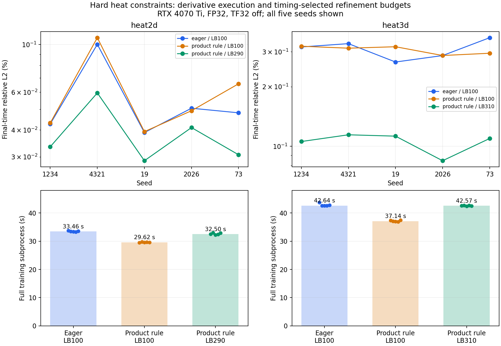

# Hard heat: точные производные по правилу произведения

2026-10-13. Добавлен экспериментальный backend `product_rule`. На RTX 4070 Ti
он сокращает полный train при одинаковом бюджете на 11.5% в 2D и 12.9% в 3D.
Если потратить сэкономленное время на дополнительный L-BFGS, ошибка последнего
слоя в 3D уменьшается примерно в 2.9 раза при практически прежнем времени.
Это две разные причины выигрыша: более дешёвые производные и больший бюджет
оптимизации. Само преобразование не повышает точность на каждом seed.

## Математическая конструкция

Область Ω = ∏[aᵢ,bᵢ], время [t₀,t₁], Lᵢ = bᵢ−aᵢ > 0, T = t₁−t₀ > 0.
Уравнение: u_t − κ Δu = 0, κ = 0.1. Сохраняем тот же класс моделей:

$$
\xi_i=\frac{x_i-a_i}{L_i},\quad
\beta_i=4\xi_i(1-\xi_i),\quad
B=\prod_{i=1}^{d}\beta_i,\quad
\tau=\frac{t-t_0}{T}.
$$

$$
u_\theta(\mathbf{x},t)=g(\mathbf{x})+\tau B(\mathbf{x})N_\theta(\mathbf{x},t).
$$

При t=t₀ поправка равна нулю: u=g. На любой грани B=0, поэтому u=g=0
при совместимом начальном поле. Значения g из float32 sin(pi*x) на границах
могут иметь погрешность округления порядка 1e−8; машинные измерения BC
приведены в CSV. Никакого аналитического решения во время обучения нет.

В исходном backend autograd дифференцирует всю композицию g+τBN. Теперь
применяем правило произведения явно, сохраняя autograd для g и N.
Обозначим Qᵢ = ∏ⱼ≠ᵢ βⱼ. Тогда:

$$
Q_i=\prod_{j\ne i}\beta_j,\qquad
B_i=Q_i\frac{4(1-2\xi_i)}{L_i},\qquad
B_{ii}=-\frac{8Q_i}{L_i^2}.
$$

Индексы i/ii здесь означают производные по физической координате xᵢ,
а не по нормализованной ξᵢ. Qᵢ считается прямым произведением: никогда не
используем B/βᵢ. Поэтому формулы конечны на гранях, рёбрах и углах.
На границе B может быть нулём, но B_i не обязан быть нулём: Дирихле
фиксирует значение, сохраняя свободу нормальной производной.

Поскольку g не зависит от текущего времени, τ_t=1/T, B_t=0:

$$
\begin{aligned}
u_t&=\frac{B}{T}N+\tau BN_t,\\
u_{tt}&=\frac{2B}{T}N_t+\tau BN_{tt}.
\end{aligned}
$$

По пространственной координате:

$$
\begin{aligned}
u_i&=g_i+\tau(B_iN+BN_i),\\
u_{ii}&=g_{ii}+\tau(B_{ii}N+2B_iN_i+BN_{ii}).
\end{aligned}
$$

Следовательно, тот же heat residual:

$$
r=\frac{B}{T}N+\tau BN_t
-\kappa\left[\Delta g+\tau\left((\Delta B)N+2\nabla B\cdot\nabla N+B\Delta N\right)\right].
$$

Не делим residual на τB и не меняем его единицы или веса loss. N_i и N_t
уже получены по физическим координатам через autograd FCN, включая его
нормализацию входов. Дополнительно масштабировать их через 1/L или 1/T нельзя:
это дважды применило бы цепное правило.

Сохраняется и градиент по весам θ. Например, пространственный член имеет:

$$
\partial_\theta u_{ii}=\partial_\theta g_{ii}
+\tau\left(B_{ii}\partial_\theta N+2B_i\partial_\theta N_i+B\partial_\theta N_{ii}\right).
$$

Первые и вторые координатные производные N вычисляются с create_graph=True,
поэтому ∂θN_ii не теряется. Производные g тоже не отсоединены. Отдельный тест
использует обучаемый параметр одновременно в g и N и сравнивает градиент loss.
Для L = mean(r²) сохранение r и ∂θr сохраняет ∂θL = mean(2r∂θr).

Это равенства вещественной арифметики. FP32 меняет порядок округлений, поэтому
равенство градиентов в допусках не гарантирует одинаковую траекторию Adam
и L-BFGS на тысячах итераций. Качество проверено отдельными обучениями.

## Интеграция и ограничения кеша

HardBoxDerivatives содержит геометрию и два Equation-контекста: для g и N.
HardBoxInitial возвращает обычный по интерфейсу dict полей со служебным
правилом производных. Equation.diff использует правило для первого/второго
порядка, не меняя пользовательские functions.py и e.dt/e.laplacian.

Кеш живёт только внутри текущего forward. Новый batch, шаг Adam или closure
создаёт новый объект. Нет detached training cache или повторного использования
графа после изменения весов. Отдельно проверены константные поля, неиспользуемые
координаты и три последовательных обновления параметра с изменением точек.

Для более высоких порядков и Tensor-выражений остаётся обычный autograd.
Геометрия сохраняет координатный граф, поэтому дальнейшее дифференцирование
подготовленных производных не теряет её вклад. Проверен третий порядок.
В predict без градиентов остаётся прежнее вычисление физического поля.
Новый режим не складывается с fused_predict через текущий YAML enum.

Веса, optimizer state и математический checkpoint-контракт не перепараметризованы.
Checkpoint записывает execution backend обучения; возможен переход product_rule
→ eager при predict. Проверен публичный train → L-BFGS → save/load → predict.
Независимый PDE holdout намеренно удаляет служебное правило из mapping и
дифференцирует физическое u полным autograd.

## Контроль, стек и численные проверки

Windows RTX 4070 Ti, Torch 2.1.0+cu118, FP32, TF32 выключен. FCN 32×32×32,
Adam lr=0.001, batch128, fixed LHS1024, затем полный L-BFGS с прежними
history/tolerance/line-search. Численные случаи: [0,1]^d, время [0,0.5], нулевой Дирихле.
Сетка оценки: heat2d 41²×31, heat3d 17³×31.
PDE holdout2048, seed20261013. Seed обучения: 1234,4321,19,2026,73.

Screening на одинаковых сохранённых весах: checkpoints TASK-11
lbfgs-staged-hard-002/heat2d-1234 и heat3d-1234, Adam3000+LB100.
SHA256 есть в сырых screening JSON. Вызовы измеряются после warmup;
порядок eager/product_rule меняется между тремя повторами.

| Сценарий residual+backward | Eager, ms | Product rule, ms | Экономия |
| --- | ---: | ---: | ---: |
| heat2d batch128 | 7.252 | 6.152 | 15.17% |
| heat2d batch2048 | 7.594 | 6.295 | 17.10% |
| heat3d batch128 | 10.258 | 8.536 | 16.79% |
| heat3d batch2048 | 10.524 | 8.672 | 17.59% |

Также проверены batch1024 и неполный batch17. Максимальная разница residual
на checkpoints ≤5.365e−7, gradient по параметрам ≤4.506e−8. Это fixed-weight
screening без optimizer updates, а не показатель времени достижения точности.
CPU/GPU тесты FP64/FP32 проверяют поле, первые/вторые производные, residual
и gradient по обучаемому параметру на смещённых областях 1D–3D, в углах,
на гранях, при t=t₀ и рядом с границами. Допуски тестов: FP64 2e−12,
FP32 3e−5, учитывая масштаб тестовых полей; screening допуски и фактические
ошибки отдельно сохранены в коде и JSON.

## Длительные обучения: одинаковый бюджет

20 запусков, code9d1c98d. Одинаковые Adam3000+LB100, выборки и seeds;
порядок backend чередуется по seed. Аналитика только после обучения.
Все 20 прошли прежние quality gates, пороги не ослаблялись.
Медианы по пяти seed:

| Case/backend | Train, s | Общий L2, % | Последний L2, % | PDE RMSE |
| --- | ---: | ---: | ---: | ---: |
| heat2d eager | 33.4575 | 0.023262 | 0.048091 | 0.001896 |
| heat2d product_rule | 29.6195 | 0.023930 | 0.049166 | 0.001961 |
| heat3d eager | 42.6450 | 0.088688 | 0.317291 | 0.004247 |
| heat3d product_rule | 37.1445 | 0.090633 | 0.312831 | 0.004253 |

Полный train включает запуск процесса, fit, refinement и запись результата,
но не отдельный predict. Экономия train 11.47%/12.90%. Медианный peak allocated
2D:24930304→24548864 bytes; 3D:27481088→26976768 bytes. Память не выросла.
Инференс этим backend не ускоряется: без градиентов путь прежний.

Случаи ухудшения честно остаются в матрице. Например, seed73 heat2d:
последний L2 0.04809%→0.06566% (+36.5% относительно маленькой ошибки).
Seed19 heat3d:0.2664%→0.3182%. Поэтому утверждение «точность не ухудшается
на каждом seed при том же числе шагов» не подтверждено.

## Сопоставимый бюджет времени

Дополнительный бюджет выбран только по timing предыдущей матрицы:

    extra = floor_to_10(100 · (median_time_eager − median_time_product)
                       / median_time_product_LB100).

Получились LB290 для heat2d и LB310 для heat3d, Adam3000 неизменен.
Manifest записан в a4f9be2 ДО новых запусков. Нет подбора по ошибке или
выбора лучшего checkpoint. Все десять дополнительных запусков прошли gates.

| Case/вариант | Train, s | Общий L2, % | Последний L2, % | PDE RMSE |
| --- | ---: | ---: | ---: | ---: |
| heat2d eager LB100 | 33.4575 | 0.023262 | 0.048091 | 0.001896 |
| heat2d product LB290 | 32.5022 | 0.016254 | 0.033412 | 0.001410 |
| heat3d eager LB100 | 42.6450 | 0.088688 | 0.317291 | 0.004247 |
| heat3d product LB310 | 42.5677 | 0.032812 | 0.109503 | 0.001733 |

По каждой паре global L2, final L2 и PDE RMSE улучшились:10/10.
В 3D final L2 лучше в 2.90 раза по медианам, global L2 — в 2.70 раза.
Отклонения wall time по seed:2D от −3.76% до −1.22%, 3D от −2.64% до +0.18%.
Это сопоставимое время, не строгая идентичность. Поздние шаги L-BFGS имеют
другую стоимость и число closure, поэтому линейный прогноз бюджета приблизителен.
Max error у heat2d seed2026 вырос с0.00030394 до0.00032381, несмотря на снижение
средних ошибок. Не утверждаем улучшение каждой метрики в каждой точке.



Всего:30 обучений,90000 Adam calls,5000 внешних LB calls,9576 closures,
21325824 посещения PDE-точек. Counts и timings разделены в CSV; дополнительные
LB iterations не выдаются за ускорение вычисления одного шага.

## Что остаётся неподтверждённым

Не измерен первый момент достижения заранее заданной точности: у этих запусков
фиксированный конец обучения. Следующий метод — snapshots по заранее заданному
графику без analytic feedback во время обучения, оценка после завершения,
проверка устойчивого прохождения gates и учёт snapshot overhead.

Полной CUDA kernel decomposition нет: предыдущий Kineto trace не зарегистрировал
CUDA events. Нулевой счётчик не доказывает отсутствие launches. Нет измеренной
Amdahl-границы или проверки compile/graphs; нельзя объявлять эти идеи реализованными.
TASK-21 остаётся In Progress до оставшейся диагностики; hard и execution defaults
в этом блоке не изменены. Новые типы BC, variable parameters, tensor conductivity
и другие PDE не объявляются численно подтверждёнными этим heat-экспериментом.

Для гладкого классического heat-решения на начальной границе недостаточно
только g|Γ=h(t₀): требуется также h_t(t₀)=κΔg+f на Γ. Например, g=x(1−x),
h=0,f=0 не удовлетворяет этой дополнительной совместимости, хотя g гладкое.
Возникающий начальный пограничный слой может усложнить PINN. Это условие
регулярности, а не запрет на слабое решение; валидатор сейчас проверяет только
совпадение значений. Наши синусоидальные eigenmode cases совместимы.

## Проверки, исправление отчёта и воспроизведение

Финальный полный CPU check: Ruff, format, strict mypy52 файлов,262 tests.
Быстрый после небольших дополнений:242 passed,20 e2e deselected.
Профильный CPU train/refine/predict и derivatives:10 passed на этапе интеграции;
финальный derivatives suite:10 passed. Windows с явно указанным CUDA backend:
scripts/check_backend.py --device cuda —8 passed; сначала6 derivative cases,
после интеграции9, после дополнения10 tests (шесть dtype/dimension случаев
выбирают CUDA, остальные проверяют dispatch/fresh graph на CPU).
Длительные CUDA train/predict/holdout:30/30 passed, refinement_device=cuda:0.

Исправление предыдущего отчёта:19 тестов на Windows в первом блоке были вызваны
без PINN_TEST_DEVICE и hardware suite использовал CPU. Они не считаются CUDA
acceptance. Benchmark самого первого блока явно использовал CUDA и остаётся
валидным. В этом блоке backend выбран через check_backend.py и env=cuda.

Пример (PowerShell после directory guard AGENTS.md, новый output directory):

```powershell
.\.venv\Scripts\python.exe scripts/benchmark_solutions.py --device cuda --profile standard --cases heat2d heat3d --steps 3000 --seeds 1234 4321 19 2026 73 --constraints hard_initial_dirichlet --hard-execution product_rule --lbfgs-steps 100 --output-dir numerical-reports/hard-rule-replay
```

Сырые данные: [CSV всех 30 запусков](experiments/2026-10-13-hard-rule-matrix.csv),
[фиксированный бюджет JSON](experiments/2026-10-13-hard-rule-matrix.json),
[расширенный бюджет JSON](experiments/2026-10-13-hard-rule-wall.json),
[manifest бюджета](experiments/2026-10-13-hard-rule-wall-budget.json),
[screening2D](experiments/2026-10-13-hard-derivatives-2d-001.json),
[screening3D](experiments/2026-10-13-hard-derivatives-3d-001.json).
Checkpoints/MAT/logs сохраняются на Windows в numerical-reports/hard-rule-*.

Следующий архитектурный блок — TASK-22, затем TASK-23/24 с расширением BC.
До его реализации не распознаём heat через имя Python-функции и не включаем
универсальный hard автоматически. Пользовательский API описан в API.md.
