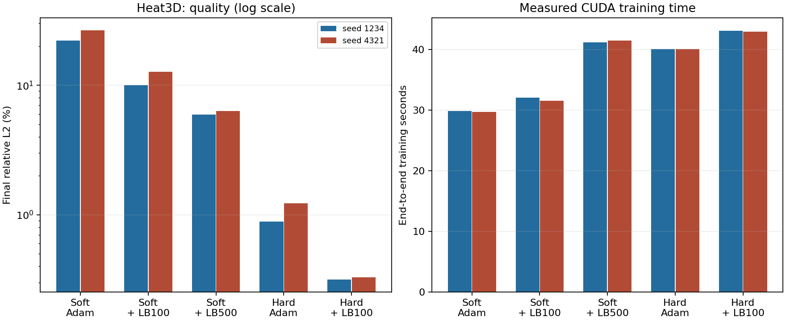

# Adam → L-BFGS и комбинация с hard constraints

Продолжение [первого отчёта](accuracy-experiments-2026-10-13.md).
Ветка `codex/model-accuracy`. Все принятые численные сравнения выполнены на
Windows RTX 4070 Ti, Torch 2.1.0+cu118 / CUDA 11.8 / Lightning 2.1.0, FP32,
TF32 выключен. Версии библиотек не менялись. Defaults остались прежними.

Принятые данные: **34 численных запуска**, 102900 Adam-шагов,
2400 внешних L-BFGS-вызовов, 4728 closures и 18012672 посещения PDE-точек.
Ещё 12 первых staged-прогонов исключены из CUDA-сравнения по причине ниже.
Из 34 корректных запусков 29 прошли абсолютные численные gates, 5 дали
отрицательный результат по качеству. Они сохранены, пороги не ослаблялись.

## Реализация

После обычного Adam можно включить отдельную стадию:

```yaml
training:
  steps: 3000
  optimizer: {learning_rate: 0.001, weight_decay: 0}
  constraints: hard_initial_dirichlet  # либо soft
  refinement:
    steps: 100
    learning_rate: 1.0
    history_size: 50
```

`steps` здесь означает 3000 Adam-шагов **и ещё** 100 вызовов L-BFGS.
Флаг бенчмарка: `--lbfgs-steps 100`; 0 выключает стадию.
Другие настройки и ограничения описаны в [API.md](API.md#adam--l-bfgs).

L-BFGS вызывает closure несколько раз для проверки кандидатов шага и градиентов.
Весь objective должен оставаться одинаковым: фиксируем последние IC/BC/PDE-точки
на всю стадию, даже если Adam использовал resampling. На каждый closure создаём
новые coordinate leaves с прежними значениями, чтобы их градиенты не накапливались.
Используется полный batch каждой группы; сохраняется нормализация граничных
операторов, в том числе разных Neumann/Robin/Dirichlet constraints.

Torch L-BFGS: strong Wolfe, max_iter=1, history 50, tolerance_grad=1e-7,
tolerance_change=1e-9. Внешний вызов не всегда изменяет веса при достижении
внутреннего порога. Поэтому считаем вызовы optimizer, closures, internal iterations
и посещения PDE-точек отдельно. Аналитические ошибки не участвуют в line search.
Сравнение ниже проверяет **полноразмерную стадию L-BFGS целиком**; не разделяет
эффект нового оптимизатора и смены minibatch на full objective. Для этого нужен
отдельный full-batch Adam-контроль.

Сохраняются adam.ckpt и final.ckpt. global_step остаётся числом Adam-шагов.
Финальный checkpoint содержит отдельные optimizer/history, fixed batches,
recipe/version, completed и фактическое устройство стадии. Проверено точное
продолжение отдельной стадии после восстановления состояния и перенос GPU → CPU.
Файловый CLI по-прежнему fine-tune весов, не автоматический полный resume стадий.

## Протокол

Два seed: 1234 / 4321, сеть 32×32×32, initial Adam LR 0.001,
1024 фиксированные LHS PDE-точки, Adam batch 128. Диагностика градиентов каждые
200 Adam-шагов. Оценочные сетки и независимые 2048 PDE holdout-точек прежние,
holdout seed 20261013. Измеряем конечные веса; не выбираем checkpoint по аналитике.

Режимы: soft/Adam, soft/Adam→L-BFGS, hard/Adam, hard/Adam→L-BFGS.
Для advection hard-адаптер неприменим, проверяем только soft.
Все 12 свежих Adam-контролей воспроизвели прежние численные метрики **в точности**.

В таблицах пары чисел означают seed 1234 / 4321, ошибки L2 указаны в процентах.
training_seconds включает весь процесс обучения; отдельно lbfgs_seconds — время
стадии с синхронизацией CUDA. Память — peak PyTorch allocated за обе стадии,
не вся GPU-память драйвера. Времена зависят от этих маленьких сетей и данного ПК.

## Heat3d: основной результат

| Режим | Общая L2, % | Последняя L2, % | PDE RMSE | Время, с |
|---|---:|---:|---:|---:|
| Soft, Adam 3000 | 9.155 / 11.393 | 22.167 / 26.546 | 0.04462 / 0.05632 | 29.81 / 29.64 |
| Soft, Adam 3000 + LB100 | 4.302 / 5.351 | 9.989 / 12.718 | 0.02454 / 0.03136 | 32.03 / 31.51 |
| Hard, Adam 3000 | 0.338 / 0.357 | 0.889 / 1.227 | 0.01085 / 0.01308 | 40.06 / 40.06 |
| **Hard, Adam 3000 + LB100** | **0.086 / 0.109** | **0.317 / 0.330** | **0.00421 / 0.00462** | **43.04 / 42.93** |

Hard + L-BFGS улучшил все указанные метрики на обоих seed.
Стоимость стадии: 2.87/2.89 s, 203/205 closures. Дополнительные PDE-посещения:
207872/209920 против 384000 в Adam. Это не 100 обычных minibatch-шагов.
IC/BC сохраняют машинные остатки, качество внутри области тоже улучшилось.

Пик allocated hard: 18.43 → 27.48 MB (+49%), reserved: 23.07 → 33.55 MB.
Для soft: 18.48 → 28.68 MB (+55%). При столь малой абсолютной памяти это
помещается на RTX 4070 Ti, но большой full objective может потребовать больше.
Chunking пока не реализован; заменять им loss без корректной глобальной
нормализации граничных constraints нельзя.

Инференс не получает новую стадию: вычисляется тот же forward с другими весами.
Heat3d warm inference примерно 19–22 ms для soft и 47 ms для hard на 152303
значениях. Стоимость hard transform остаётся; L-BFGS не устраняет её.

## Контроль при сопоставимом wall-time

Чтобы не приписывать дополнительное обучение новому оптимизатору, подобрали
число дополнительных Adam-шагов **только по времени**, не по ошибке:
из staged target time вычитается фиксированная стоимость контрольного процесса,
остаток делится на измеренную стоимость Adam-шагов; округление до 10 шагов.
Фактическое расхождение длительностей всех четырёх пар меньше 0.7%.

| Heat3d | Контроль Adam: шаги / время | L-BFGS: время | Последняя L2 контроля / staged, % | PDE RMSE контроля / staged |
|---|---:|---:|---:|---:|
| Hard 1234 | 3230 / 42.94 s | 43.04 s | 0.952 / **0.317** | 0.00994 / **0.00421** |
| Hard 4321 | 3230 / 42.95 s | 42.93 s | 0.761 / **0.330** | 0.01222 / **0.00462** |
| Soft 1234 | 3240 / 31.83 s | 32.03 s | 18.783 / **9.989** | 0.04303 / **0.02454** |
| Soft 4321 | 3200 / 31.41 s | 31.51 s | 31.652 / **12.718** | 0.05440 / **0.03136** |

Выигрыш сохраняется при практически равном времени. Дополнительные Adam-шаги
не гарантируют монотонного уменьшения аналитической ошибки: soft 4321 последняя
ошибка выросла. Это фиксированный конечный checkpoint, а не выбор лучшего слоя.
Стоимость и ошибки каждого запуска сохранены в CSV, а правило выбора бюджета
в `numerical-reports/lbfgs-wall-schedule-001.json`.

## Другие PDE

Adam 3000 против Adam 3000 + LB100; те же два seed.

| PDE / режим | Общая L2 Adam → staged, % | Последняя L2 Adam → staged, % |
|---|---:|---:|
| Heat2d soft | 2.047 / 2.122 → 0.493 / 0.563 | 4.126 / 4.874 → 1.177 / 1.273 |
| Heat2d hard | 0.155 / 0.176 → **0.021 / 0.042** | 0.510 / 0.470 → **0.043 / 0.100** |
| Forced Burgers soft | 0.287 / 0.547 → 0.087 / 0.160 | 0.408 / 0.767 → 0.095 / 0.372 |
| Forced Burgers hard | 0.075 / 0.624 → **0.008 / 0.011** | 0.154 / 1.516 → **0.014 / 0.018** |
| Advection soft | 0.357 / 0.497 → 0.215 / 0.104 | 0.557 / 0.508 → 0.218 / 0.102 |

PDE holdout улучшился во всех этих парах. Все шесть hard+LB100 запусков прошли
quality gates; у soft+LB100 heat3d 4321 общая ошибка 5.35% всё ещё выше порога 5%.
На Burgers прежний проблемный seed теперь получил высокую точность уже на
3000 Adam + 100 L-BFGS, без необходимости удваивать Adam-бюджет.

Время стадии: heat2d hard 2.25 s; Burgers hard 1.19–1.28 s;
advection 1.23–1.39 s. Advection полный train вырос с 19.1–19.4 до 20.4–20.7 s.
Число closures различается по seed: например, Burgers hard 139/133,
advection 205/169. Поэтому одинаковые optimizer calls не равны одинаковой работе.

## Новая гипотеза: больше L-BFGS без hard

Из результата soft100 возникла гипотеза недостаточной сходимости полноразмерной
стадии. Проверили soft500, сохранив Adam 3000 и остальные настройки.

| Режим | Общая L2, % | Последняя L2, % | Время, с |
|---|---:|---:|---:|
| Soft + LB500 | 1.993 / 2.348 | 5.958 / 6.303 | 41.18 / 41.41 |
| Hard + LB100 | **0.086 / 0.109** | **0.317 / 0.330** | 43.04 / 42.93 |

Оба soft500 прошли общие gates. Стадия заняла 11.50 s, 1026/1017 closures;
PDE RMSE 0.01138/0.01524. Дополнительная оптимизация помогает soft, но при
похожем общем времени hard+LB100 остаётся намного точнее. Точный IC/BC и
представление поля сохраняют самостоятельную ценность. Это не доказательство
фундаментального предела soft PINN; ограничены архитектура и исследованный бюджет.



## Важная ошибка интеграции и исправление

Первый скрининг `lbfgs-staged-*-001` выявил ошибку: Lightning 2.1 после fit
вызывает strategy.teardown и переносит модель/Adam state на CPU. Я не учёл это
при запуске отдельной стадии. Adam выполнялся на GPU, L-BFGS — на CPU Windows.
Те 12 staged-запусков не входят в принятые CUDA-таблицы и не используются
для сравнений производительности. Их низкий memory peak был признаком проблемы.

Исправление: явный `model.to(trainer.strategy.root_device)` перед снимком данных
и построением L-BFGS. Фактический device записывается в checkpoint/result.
Добавлен аппаратный public-runner тест, который проверяет именно устройство
стадии после fit, а не только наличие CUDA. Бенчмарк независимо отклоняет
неверный backend, неполную стадию и неправильное число вызовов. CPU unit-тест
сам по себе такой межстадийный CUDA-дефект поймать не мог.

## Проверки и воспроизводимость

* Итоговый Mac `check.py --full`: **244 passed**, 87.86 s; Ruff, format,
  strict mypy, 49 source files. Общий configured CPU-набор включает e2e,
  аппаратные тесты запускаются отдельно.
* Отдельно на Mac: **3 CPU backend/refinement теста**.
* Windows CUDA acceptance: **8 passed**, 0 failed/skipped, 18.65 s,
  commit `e5a56b7`, включая public backend и GPU→CPU state transfer.
* Windows профильные stage/runner тесты: **10 passed**; benchmark/guard:
  **18 passed**, последний commit `01cfab3`. Полный Windows CPU-набор не запускался.

Контроли: `fb55ee4`; исправленные GPU stages: `e5a56b7`; soft500 и финальный guard:
`01cfab3`. Adam-код между ними физически не менялся. Во время каждой матрицы
checkout оставался фиксированным. Windows `git diff`/`git diff --cached` пусты;
dirty flag связан с прежними неотслеживаемыми файлами. Все команды/кеши/логи
в `C:\Projects\pinn-runner`, SSH-соединения закрываются после работы.

Компактные принятые измерения: [CSV](experiments/2026-10-13-lbfgs.csv).
Полные JSON/checkpoints/MAT/логи находятся в одноимённых `numerical-reports`
на Windows и собранные JSON на Mac. CPU-stage001 остаётся диагностическим
артефактом и явно исключён из CSV. Эти исключения не считаются успешными CUDA-тестами.

## Вывод и следующие абляции

Комбинация hard + L-BFGS подтверждена предварительным двух-seed скринингом
на heat3d/heat2d/Burgers. Выигрыш сохраняется на heat3d при равном времени.
Для defaults ещё нужны пять seed всех применимых PDE, ablation full-batch Adam,
композиционные/leave-one-out проверки. Память выросла более чем на 25%, поэтому
стратегия пока opt-in согласно ранее принятому правилу.

Следующие гипотезы: разделить эффект full batch и L-BFGS; отдельно hard IC/hard BC;
проверить, почему GPU-стадия небольшой сети тратит время на синхронизации и
множество маленьких операций. Последнее пока гипотеза, profiler не запускался.
Не приписываем выигрыш causality или обновлению библиотек: они здесь не менялись.
