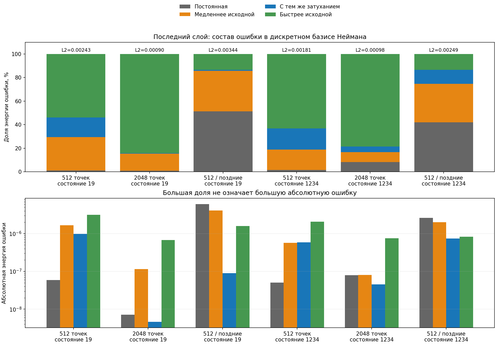

# Пространственные моды ошибки и тепловая оценка

Дополнительный разбор шести уже сохранённых решений от 15 октября 2026.
Нового обучения и предсказания здесь нет: анализ выполнен на Mac по MAT-файлам,
которые ранее получены на Windows CUDA. Настройки solver и пороги не менялись.

## Не путать исходную моду с полной ошибкой

Для прямоугольника с однородным условием Неймана собственные формы лапласиана:

$$
\Phi_{\boldsymbol k}(\boldsymbol x)
=\prod_{i=1}^{d}\cos\left(\frac{k_i\pi(x_i-a_i)}{L_i}\right),
\qquad
\mu_{\boldsymbol k}=\pi^2\sum_i\frac{k_i^2}{L_i^2},
\qquad
\lambda_{\boldsymbol k}=\kappa\mu_{\boldsymbol k}.
$$

Здесь a — нижние границы, L — длины сторон, k — неотрицательные целые индексы,
κ — постоянная теплопроводность. Собственная форма, умноженная на экспоненту
с показателем −λt, решает однородное тепловое уравнение.
В нашей задаче ненулевые заданные данные уже включены в точное решение;
разность приближённого и точного решений имеет однородное условие Неймана
с точностью вычислительного округления.

В исходном тепловом бенчмарке затухающая часть — форма с индексом (1,1,1).
Но ошибка нейросети не обязана лежать вдоль неё. Она может содержать постоянную
форму (0,0,0), более медленные и более быстрые формы. Маленькая ошибка одного
коэффициента не означает маленькую ошибку всего поля.

## Как невязка порождает каждую ошибочную моду

Обозначим ошибку e, физическую PDE-невязку r, ошибку нормальной производной δh.
Их уравнение и модальный баланс:

$$
e_t-\kappa\Delta e=r,\qquad \partial_ne=\delta h,
$$

$$
a_{\boldsymbol k}'+\lambda_{\boldsymbol k}a_{\boldsymbol k}
=R_{\boldsymbol k}+B_{\boldsymbol k},\qquad
B_{\boldsymbol k}
=\frac{\kappa\int_{\partial\Omega}\Phi_{\boldsymbol k}\delta h\,dS}
{\int_\Omega\Phi_{\boldsymbol k}^2\,dV}.
$$

R — проекция невязки на ту же форму; a — проекция ошибки. При выполненном
начальном условии коэффициент ошибки начинается с нуля, и:

$$
a_{\boldsymbol k}(T)=
\int_0^T e^{-\lambda_{\boldsymbol k}(T-s)}
\left[R_{\boldsymbol k}(s)+B_{\boldsymbol k}(s)\right]ds.
$$

Постоянная форма имеет λ=0: ошибка среднего накапливается без экспоненциального
подавления. Быстрая форма имеет большое λ, но её ошибка всё равно может быть
заметна, если невязка продолжает возбуждать её вблизи последнего времени.
Теплопроводность подавляет свободную ошибку; она не обнуляет непрерывно
вносимое возмущение. Поэтому наличие быстрых мод в поздней ошибке не
противоречит затуханию теплового оператора.

## Что именно вычислено по сохранённой сетке

MAT содержит полную равномерную декартову сетку 9×9×9 и 31 момент времени.
Из предсказания вычитается известное аналитическое поле; ошибка раскладывается
по полной **дискретной** косинусной системе с трапециевидными весами.
Для оси с M интервалами вес концов вдвое меньше веса внутренних узлов.
Коэффициенты и энергия:

$$
c_{\boldsymbol k}^{h}
=\frac{\langle e,\Phi_{\boldsymbol k}\rangle_h}
{\langle\Phi_{\boldsymbol k},\Phi_{\boldsymbol k}\rangle_h},
\qquad
E_{\boldsymbol k}^{h}
=(c_{\boldsymbol k}^{h})^2
\langle\Phi_{\boldsymbol k},\Phi_{\boldsymbol k}\rangle_h.
$$

На полной равномерной сетке эта система ортогональна в выбранном скалярном
произведении. Проверяется дискретное равенство Парсеваля:

$$
\sum_{\boldsymbol k}E_{\boldsymbol k}^{h}
=\langle e,e\rangle_h.
$$

Для последней разрешаемой частоты на оси дискретная норма отличается от
непрерывной: её квадрат равен L, а не L/2. Это учтено явно. Проверены
сдвинутые прямоугольники 1D–3D, постоянная и последняя разрешаемая формы,
порядок декартовых строк, неправильные/неравномерные сетки и настоящий MAT-формат.
Концы строк Windows в `functions.py` нормализуются при сравнении текста;
изменение самого текста постановки отклоняется, оба хеша записываются.

Это **не** непрерывный спектр и не строгая оценка непрерывной ошибки:
неразрешённые высокие частоты могут выглядеть как более низкие на грубой сетке.
Также это другое скалярное произведение, чем равные веса всех 9³ точек в
первоначальной метрике. Старые показатели и пороги не заменяются задним числом.

## Полученный результат

Доли ниже относятся к квадрату нормы ошибки на последнем временном слое.
«Медленные» не включают постоянную форму; «та же скорость» относится к λ
исходной формы (1,1,1). Все числа — из сохранённой дискретной сетки.

| Выборка | Состояние | Постоянная | Медленные | Та же скорость | Быстрые |
|---|---:|---:|---:|---:|---:|
| 512 равномерно | 19 | 1,01% | 28,32% | 16,79% | 53,88% |
| 2048 равномерно | 19 | 0,89% | 14,39% | 0,57% | 84,15% |
| 512, поздняя плотность | 19 | 51,24% | 34,52% | 0,75% | 13,48% |
| 512 равномерно | 1234 | 1,55% | 17,24% | 17,94% | 63,28% |
| 2048 равномерно | 1234 | 8,21% | 8,40% | 4,76% | 78,63% |
| 512, поздняя плотность | 1234 | 42,03% | 32,70% | 11,96% | 13,31% |

Гипотеза «поздняя ошибка в основном состоит из медленно затухающих форм»
**не подтвердилась для равномерных выборок**: быстрые формы дают 54–84%.
В частности, заметны индексы (3,1,1), (1,3,1), (1,1,3). После увеличения
числа точек их доля стала выше, но абсолютная энергия ниже: всё решение
стало точнее. Доли нельзя сравнивать без общего масштаба ошибки.

У неудачной поздней плотности доминируют постоянная и медленные формы.
Это согласуется с ранее измеренной плохой невязкой у начала времени и
накоплением ошибки среднего, но само по себе не доказывает единственную
причину провала. Уменьшение ошибки только исходной формы скрывает проблему.

Сырые результаты: [JSON](experiments/2026-10-15-neumann-spectra.json).
Код: `benchmarks/cosine_spectrum.py`, `scripts/benchmark_cosine_spectrum.py`.
Обучение, новые веса и аналитический учитель в solver не добавлялись.

## Что можно оценивать без аналитического ответа

При **точном** однородном условии ошибки Неймана формула энергии даёт:

$$
\frac12\frac{d}{dt}\|e\|_{L^2}^2
+\kappa\|\nabla e\|_{L^2}^2
=\langle r,e\rangle.
$$

Из неравенства Коши и интегрирования следует грубая оценка:

$$
\|e(T)\|_{L^2}
\leq\|e(0)\|_{L^2}+\int_0^T\|r(s)\|_{L^2}\,ds.
$$

После выделения среднего ошибка с нулевым средним затухает не медленнее
первой положительной собственной формы Неймана:

$$
\|e_\perp(T)\|_{L^2}
\leq e^{-\lambda_1T}\|e_\perp(0)\|_{L^2}
+\int_0^T e^{-\lambda_1(T-s)}\|r_\perp(s)\|_{L^2}\,ds,
\qquad
\lambda_1=\frac{\kappa\pi^2}{\max_i L_i^2}.
$$

Это объясняет, зачем независимо контролировать среднее через тепловой баланс
и полную невязку по времени. Такие оценки не требуют знания всего точного
решения, но конечная квадратура невязки ещё не является строгой верхней
границей её непрерывной нормы. При ненулевом дефекте граничной производной
появляется дополнительный граничный вклад; его нельзя молча отбросить.
Для Робина нужны соответствующие собственные формы и условия устойчивости
оператора, поэтому текущая косинусная диагностика к нему не применяется.

Ближайшее подтверждение гипотезы — измерить проекции на более точной независимой
квадратуре, сохранив различие между погрешностью интегрирования и ошибкой модели.
Автоматическое изменение весов невязки по этим модам пока не реализовано.
