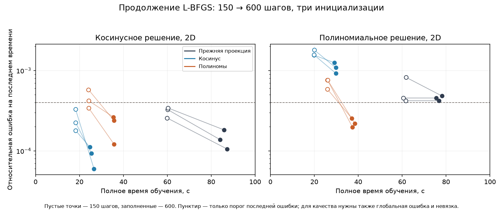

# Время достижения строгой точности: признаки Неймана

Продолжение [первой серии](neumann-feature-study-2026-10-16.md).
18 новых CUDA-обучений на двух уравнениях 2D, трёх представлениях и seed
19,1234,4321. В сумме двух серий — 42 обучения. Основной режим не меняется.

## Условия сравнения

[Протокол](experiments/2026-10-17-neumann-quality-protocol.json) зарегистрирован
до новых обучений, но после просмотра первой серии. Поэтому это исследование
новой гипотезы, а не независимая слепая валидация. Сохраняются 2000 шагов Adam,
1024 точки, архитектура, фон, источники и текущий стек Torch2.1/cu118.
Предел L-BFGS увеличен со150 до600 шагов. Источник запуска — `818268e`;
математический код обучения совпадает с `8b0f73f`.

Пороги: глобальная относительная ошибка ≤2·10⁻⁴, последняя ≤4·10⁻⁴,
RMS физической невязки ≤0,003; на косинусном контроле дополнительно ошибка
моды ≤0,001. Нужно два соседних успешных состояния. Известны интервалы,
а не точные моменты пересечения непрерывной кривой качества.

У всех 18 пар совпали начальные отпечатки весов и фиксированных точек с
первой серией. Все **126** общих состояний до150 включительно дали ровно
одинаковые метрики. Значит, продолжение бюджета в этой серии воспроизводит
прежнюю численную траекторию на проверенных состояниях; это не утверждение
о битовой воспроизводимости любых CUDA-операций в других экспериментах.

## Подтверждённые достижения порога

«Верхняя граница» — время первого успешного состояния подтверждённой пары.
Подтверждение получается только при следующем успешном состоянии. Диапазоны
в таблице относятся к трём seed; точные интервалы каждой пары сохранены в CSV.

| Контроль | Представление | Подтверждено | Верхние границы, с | Подтверждение, с |
|---|---|---:|---:|---:|
| Косинусный | Прежняя проекция | 3/3 | 69,88–75,01 | 75,63–80,80 |
| Косинусный | Косинус | 3/3 | 18,36–21,40 | 19,34–23,41 |
| Косинусный | Полиномы | 0/3 | — | — |
| Полиномиальный | Прежняя проекция | 0/3 | — | — |
| Полиномиальный | Косинус | 0/3 | — | — |
| Полиномиальный | Полиномы | 3/3 | 33,01–33,38 | 35,51–36,04 |

Полиномиальное представление на косинусном контроле наблюдалось 35,48–35,73 с;
у seed1234 последнее состояние прошло критерии, но второго последующего
успеха нет. Остальные два не прошли строгую невязку. Это ограниченный бюджет,
а не доказательство невозможности достижения порога.

На полиномиальном контроле прежний метод наблюдался 75,57–78,17 с, косинусный —
29,12–29,89 с. Подтверждённых пар нет. Нельзя подставлять эти времена вместо
неизвестного времени достижения и выдавать отношение за точное ускорение.

[18 конечных результатов](experiments/2026-10-17-neumann-quality-final.csv),
[216 состояний](experiments/2026-10-17-neumann-quality-snapshots.csv),
[среда и воспроизводимость](experiments/2026-10-17-neumann-quality-summary.json).
Сырые отчёты и веса остаются Windows: `numerical-reports/neumann-quality-002`.

Пунктир на графике показывает только порог последней ошибки; прохождение
всех критериев определяется также глобальной ошибкой и невязкой.

## Неожиданная остановка прежнего метода

На полиномиальном контроле прежняя проекция после примерно125–150 шагов
даёт неизменные ошибки вплоть до600. За каждые дополнительные100 вызовов
прибавляется ровно100 вычислений функции потерь. Это похоже на остановку
до поиска длины шага внутри L-BFGS, а не на обычное медленное улучшение.

У замерших весов максимум градиента на восстановленных исходных точках
намного выше `tolerance_grad`. Но для окончательного вывода нужна история
оптимизатора, которой в файлах весов нет. Поэтому прежде чем приписывать
неудачу самому пространству функций, проверяется [порог направленной
производной](lbfgs-directional-tolerance.md) в отдельном коротком CUDA-повторе.
Основные настройки пока не меняются.

## Короткий профиль фактических вычислений

На трёх сохранённых состояниях seed19 косинусного контроля выполнен отдельный
профиль 1024 одинаковых физических точек, без обновления оптимизатора.
Отпечатки весов до и после совпали. Код инструмента — `484f9d9`.

| Представление | Вызовы FCN | Строки FCN | Медиана потерь и градиента, мс |
|---|---:|---:|---:|
| Прежняя проекция | 4 | 9216 | 24,079 |
| Косинус | 1 | 1024 | 5,544 |
| Полиномы | 1 | 1024 | 8,035 |

Это три прогрева и девять синхронизированных CUDA-измерений; отдельный проход
профилировщика в них не входит. Подтверждена экономия работы, выведенная
математически как переход с3ᵈN к N строкам. Это время вычисления функции
потерь и градиента, а не полного шага Adam/L-BFGS с поиском длины шага.

**Ограничение:** установленный PyTorch на Windows сообщает отсутствие CUDA-
активности `torch.profiler`. Получены CPU-операторы и синхронизированные
времена работы на GPU, но не времена отдельных GPU-ядер. Поэтому задача
полного профиля CUDA-ядер остаётся открытой.

[Сводка профиля](experiments/2026-10-17-neumann-profile-summary.json),
[267 строк операторов](experiments/2026-10-17-neumann-profile-operators.csv).
Большие `trace.json` оставлены на Windows в `numerical-reports/neumann-profile-003`.

## Вывод

Признаки уменьшают вычислительную цену, но их точность зависит от формы решения.
Универсального победителя эта серия не даёт. Полиномиальный вариант успешно
использует дополнительный бюджет на своём контроле; косинусный эффективнее
на косинусном. Следующий приоритет — проверить остановку оптимизатора,
затем повторить сравнение с осмысленными критериями остановки. Расширять число
вариантов и менять основной режим до этого преждевременно.

Причинная проверка остановки завершена: [результат CUDA-повтора](lbfgs-directional-tolerance.md#результат-причинной-проверки-на-cuda).
