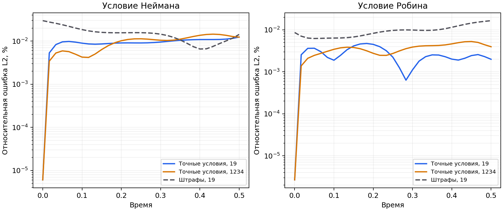

# Точные Неймана и Робина: интеграция 1D и проверка теплопроводности

2026-10-14. Область — отрезок, одно поле, постоянные коэффициенты граничных
операторов. Реализация `hard_initial_robin`; способ вычислений `eager`.
Многомерное расширение TASK-24 пока не входит в выполненный этап.

## Математический вывод

Для двух внешних нормалей операторы Робина записываются:

$$
L_-u=\alpha_-u(a,t)-\beta_-u_x(a,t),\qquad
L_+u=\alpha_+u(b,t)+\beta_+u_x(b,t).
$$

У Неймана коэффициент температуры нулевой, коэффициент производной — единица.
Обозначим нормированную координату и длину отрезка. Кубические функции Эрмита:

$$
\ell=b-a,\quad s=\frac{x-a}{\ell},\qquad
\phi_-=-\frac{\ell}{\beta_-}s(1-s)^2,\quad
\phi_+=\frac{\ell}{\beta_+}s^2(s-1).
$$

На обоих концах значения обеих функций нулевые, а их граничные операторы
образуют единичную матрицу:

$$
L_-\phi_-=1,\quad L_+\phi_-=0,\qquad
L_-\phi_+=0,\quad L_+\phi_+=1.
$$

Это следует из производных кубических функций на концах с учётом длины отрезка
и знаков нормалей. Коэффициент температуры исчезает, поскольку сами функции
на концах нулевые. Для произвольного выхода сети вычитаем граничные невязки:

$$
QN=N-\phi_-L_-N-\phi_+L_+N.
$$

Тогда оба однородных оператора от проекции нулевые. Если функция уже выполняет
условия, проекция её не меняет. Её значения на концах равны значениям исходной
сети, то есть температура остаётся свободной, дополнительное Дирихле не вводится.

Пусть начальное поле g совместимо с заданными граничными функциями при t₀.
Полное преобразование:

$$
\begin{aligned}
L_-g&=h_-(t_0),\qquad L_+g=h_+(t_0),\\
\tau&=\frac{t-t_0}{t_1-t_0},\\
u_\theta&=g
+\phi_-\left[h_-(t)-h_-(t_0)\right]
+\phi_+\left[h_+(t)-h_+(t_0)\right]
+\tau QN_\theta.
\end{aligned}
$$

В начальный момент обе разности и поправка сети равны нулю. Подстановка любого
граничного оператора оставляет начальное значение плюс его нужное изменение:

$$
u_\theta(x,t_0)=g(x),\qquad L_-u_\theta=h_-(t),\qquad L_+u_\theta=h_+(t).
$$

Гарантия математическая для гладких совместимых данных. В машинной арифметике
сохраняются ошибки округления. Совместимость производных для классического
решения в точках пересечения начального времени и границы проверяется лишь
частично: проверяется исходный Robin/Neumann оператор, не вся цепочка PDE
совместимости более высоких производных.

## Вычислительный граф и цена конструкции

`ConstraintPlan` разрешает геометрию и граничные операторы до обучения.
`IntervalRobinInitial` хранит математический рецепт; после создания FCN к нему
привязывается та же сеть, без дублирования обучаемых параметров. Сохранённая модель
содержит прежний набор весов; рецепт восстанавливается из задачи.

Один физический forward требует трёх вычислений сети: внутренние точки и
два конца с теми же временами. Уже полученный внутренний выход используется
повторно — четвёртого вычисления нет. На концах создаются независимые координаты
с autograd. Нормальная производная вычисляется с `create_graph=True`, поэтому
сохраняются дальнейшие производные по времени и весам. Геометрия и начальное
поле не отсоединяются. Во время предсказания локально включаются необходимые
производные, затем результат возвращается без графа, если граф не запрашивался.

Счётчики `adam_model_evaluations` и `lbfgs_closure_evaluations` описывают шаги/
вычисления целевой функции, а не число внутренних вызовов FCN. Для нового режима
нельзя интерпретировать их как число проходов сети. Стоимость на шаг и полное
время обучения оцениваются по времени; свойства проекции сами по себе ускорения
не обещают. Начальные/граничные штрафы исключены, но необходимые вычисления
сети на границах остались.

## Что проверяется численно

Две независимые аналитические задачи на единичном отрезке, время от 0 до 0.5,
коэффициент теплопроводности в уравнении 0.1. Источник задан заранее как координата:

$$
u_t=\kappa u_{xx}+x,\qquad \kappa=0.1.
$$

Нейман:

$$
u_*=1+tx+e^{-\kappa\pi^2t}\cos(\pi x),\qquad
h_-=-t,\quad h_+=t.
$$

Робин — подлинная собственная мода этого оператора, а не синус Дирихле:

$$
\begin{aligned}
\mu&=\frac{\pi}{2},\quad \alpha_-=\alpha_+=\mu,\quad \beta_-=\beta_+=1,\\
u_*&=1+tx+e^{-\kappa\mu^2t}\cos\left(\mu(x-\tfrac12)\right),\\
h_-&=\mu-t,\qquad h_+=\mu+(\mu+1)t.
\end{aligned}
$$

Мода Робина имеет нулевой однородный оператор на обоих концах, поскольку
коэффициент температуры выбран по равенству:

$$
\mu\cos(\mu/2)-\mu\sin(\mu/2)=0.
$$

Начальное поле, граничные функции и PDE находятся в `functions.py`.
Полное аналитическое решение есть только в независимой оценке после обучения,
в обучение не передаётся. Общий/последний/худший временной L2 и PDE оцениваются
существующим инструментом; новый `benchmark_robin_balance.py` проверяет сами
граничные операторы и интегральный баланс.

В принятых единицах теплоёмкость и плотность равны единице; интеграл температуры
соответствует тепловому содержанию. Для другой постоянной объёмной теплоёмкости
оба члена энергетического баланса умножаются на неё:

$$
M(t)=\int_a^b u(x,t)\,dx,\qquad
M'(t)=\kappa\left[u_x(b,t)-u_x(a,t)\right]+\int_a^b f(x,t)\,dx.
$$

Сравниваются производная интеграла, вычисленная через autograd, и правая часть,
а также накопленное изменение от начального времени. Квадратура — 257 пространственных
узлов и 31 временной узел, независимо от обучающей выборки. Ошибка квадратуры
входит в итоговую метрику. По аналитике ошибка скорости баланса ниже 1e-5;
искусственная пространственно постоянная прибавка 0.1t обнаруживается: она не
нарушает Неймана, но меняет баланс тепла.

## Заранее заданные пороги

Общий relative L2≤0.01, последний≤0.02, PDE RMSE≤0.02,
невязка граничного оператора RMSE≤1e-4, скорость нарушения баланса RMSE≤0.01,
накопленное нарушение≤0.005, начальная ошибка RMSE≤1e-5. Это дополнительные
исследовательские пороги, существующие общие проверки не ослаблены.
Контрольный soft-вариант оценивается по тем же числам; непрохождение сохраняется
в отчёте, а не исправляется изменением порогов. Варианты сравниваются при равном
числе шагов, не как строго равные по фактическому времени эксперименты.

## Результаты RTX 4070 Ti

Обучения выполнены на коде `7e9aecf`, Torch 2.1.0+cu118, FP32, TF32 выключен,
одна RTX 4070 Ti. Сеть 32×32×32, Adam, 3000 шагов, пакет 128, 1024 фиксированные точки
PDE; затем 100 внешних шагов L-BFGS с фиксированной целевой функцией. Числа
генератора случайных чисел для точного режима — 19/1234; контроль со штрафами — 19.
Все шесть запусков прошли прежние общие пороги. Четыре точных запуска также
прошли дополнительные заранее заданные пороги баланса и граничных операторов.

| Условие | Режим | Число | Общий L2, % | Последний L2, % | Худший L2, % | PDE RMSE | Невязка оператора RMSE |
|---|---|---:|---:|---:|---:|---:|---:|
| Нейман | точный | 19 | 0.009594 | 0.012389 | 0.012389 | 0.002638 | 1.98e-7 |
| Нейман | точный | 1234 | 0.010143 | 0.012344 | 0.014441 | 0.003124 | 2.06e-7 |
| Робин | точный | 19 | 0.002784 | 0.001988 | 0.004730 | 0.001274 | 1.61e-7 |
| Робин | точный | 1234 | 0.003727 | 0.003957 | 0.005271 | 0.001259 | 1.57e-7 |
| Нейман | штрафы | 19 | 0.016255 | 0.014242 | 0.029705 | 0.003995 | 0.001048 |
| Робин | штрафы | 19 | 0.010172 | 0.016543 | 0.016543 | 0.002088 | 0.001657 |

У точного режима начальные RMSE — 7.45e-8 (Нейман) и 5.05e-8 (Робин).
У контроля — 0.000365/0.000164. Контроль не прошёл два дополнительных порога:
начальная ошибка≤1e-5 и невязка оператора≤1e-4. Пороги не изменялись после
эксперимента; эти непрохождения сохранены в сырых отчётах.

Старый показатель `boundary_rmse` сравнивает **температуру на границе** с
аналитической температурой. Для Неймана/Робина она не задаётся непосредственно:
новый `boundary_operator_rmse` сравнивает именно заданную производную или её
сочетание с температурой. Поэтому температурная ошибка 1e-4 на конце может
сосуществовать с выполнением заданного условия до 1e-7; противоречия здесь нет.

| Условие | Режим | Число | RMSE скорости нарушения баланса | Max накопленного нарушения | Начальный интеграл | Конечный интеграл |
|---|---|---:|---:|---:|---:|---:|
| Нейман | точный | 19 | 4.81e-4 | 4.08e-5 | 1.000000 | 1.250022 |
| Нейман | точный | 1234 | 4.51e-4 | 7.65e-5 | 1.000000 | 1.249984 |
| Робин | точный | 19 | 1.40e-4 | 1.38e-5 | 1.900313 | 2.045824 |
| Робин | точный | 1234 | 3.71e-4 | 2.86e-5 | 1.900313 | 2.045814 |
| Нейман | штрафы | 19 | 1.26e-3 | 9.55e-5 | 0.999997 | 1.249965 |
| Робин | штрафы | 19 | 1.04e-3 | 8.95e-5 | 1.900364 | 2.045911 |

Точный режим не делает сохранение тепла точным автоматически: оно следует из
приближённо выполненной PDE, поэтому баланс всё равно измеряем. Для Неймана
аналитический конечный интеграл равен 1.25; это дополнительно подтверждает,
что свободная пространственно постоянная часть решения не потеряна.

### Стоимость обучения и предсказания

Предсказание 1271 значений, один пакет 2048; тёплое измерение — медиана 7 проходов
после 3 подготовительных, с синхронизацией CUDA. Холодный запуск включает Python,
загрузку модели, подготовку и запись MAT. Память — пиковое выделение PyTorch,
не вся память драйвера/GPU.

| Условие | Режим | Число | Обучение, s | Тёплое предсказание, ms | Холодное, s | Память, MiB | Вычислений L-BFGS |
|---|---|---:|---:|---:|---:|---:|---:|
| Нейман | точный | 19 | 49.28 | 2.215 | 2.340 | 28.00 | 213 |
| Нейман | точный | 1234 | 49.22 | 2.189 | 2.359 | 28.00 | 213 |
| Робин | точный | 19 | 49.51 | 2.352 | 2.329 | 27.84 | 144 |
| Робин | точный | 1234 | 49.70 | 2.342 | 2.312 | 27.80 | 145 |
| Нейман | штрафы | 19 | 26.50 | 0.264 | 2.301 | 21.11 | 202 |
| Робин | штрафы | 19 | 26.93 | 0.256 | 2.298 | 21.11 | 204 |

Суммарное время шести обучений — 251.14 s, около 4.2 минут; оценка моделей и отдельные
тесты добавляют своё время. Большая матрица из 30 запусков матрица не повторялась.

## Выводы и обнаруженные ограничения

1. Точная конструкция работает в обучаемом решателе, а не только на заданной
   вручную функции: оба вида меняющихся условий, два начальных числа, независимая
   PDE и баланс пройдены. Температура на концах остаётся неизвестной, не фиксируется
   дополнительно; нейронная сеть её выбирает по PDE и начальному полю.
2. При одинаковых 3000+100 шагах качество общего решения выше контроля примерно
   в 1.7 раза для Неймана и 3.7 раза для Робина (число 19). Граничные операторы
   и начальное поле выполняются значительно точнее, но шаг дороже. Не утверждаем,
   что время достижения одинаковой точности меньше: равный бюджет времени и
   промежуточные пересечения порогов здесь не измерялись.
3. Цена существенна: полный запуск обучения примерно в 1.8–1.9 раза дольше,
   тёплое предсказание примерно в 8–9 раз дороже контроля. Причина согласуется
   с необходимыми двумя дополнительными вычислениями сети и производными
   на концах, но полное разложение по затратам не профилировалось. Холодное
   предсказание почти одинаково: доминирует запуск приложения и работа с файлами.
4. Последний слой не обязательно худший. У Робина с числом 19 худший слой около 0.183,
   а последний точнее; у Неймана с числом 1234 максимум около 0.433. Это не доказательство
   отсутствия всех ошибок индексации, но наблюдаемая зависимость ошибки от времени
   не сводится к систематическому провалу последнего узла.
5. Обнаружена опасность переопределения интервала при загрузке модели: исходная
   сеть нормализована по обучающему интервалу, а преобразование использует его
   длину и начальное время. Подмена интервала меняет физическую функцию, даже
   если запрошенные точки лежат внутри прежнего диапазона. Для нового режима
   добавлена явная защита; менять количество узлов можно. Определение модели
   учитывает вид/коэффициенты условий и функции, но не вес штрафа.

На графике логарифмическая шкала ошибки, числа в легенде — начальные числа
генератора. Почти нулевая ошибка точного режима при t₀ задаётся конструкцией.
Она не означает нулевую ошибку во всём последующем времени.

## Проверки и воспроизводимость

Полный финальный `python scripts/check.py --full`: **308 прошли, 127.78 s**,
Ruff/форматирование и строгая проверка типов 65 файлов. После уточнения проверки
исходных функций инструмента баланса выполнен быстрый набор:
**285 прошли, 23 e2e исключены**, строгая проверка типов нового скрипта также прошла.
Отдельный файловый цикл новой функции:2 e2e прошли за 14.85 s.

Windows на `a695fec`: **19 прошли, 21.60 s**. Десять проверок действительно
использовали GPU: шесть сочетаний коэффициентов/типов данных, два случая
проверки собранной модели, два файловых цикла. Девять проверок ошибочных
конфигураций/определения модели выполнялись на CPU. Начальный набор на 7e9aecf:
17 прошли; численные обучения всех шести моделей относятся к 7e9aecf.

Уточнённый скрипт баланса проверяет исходный файл известного benchmark перед
использованием источника x и проходит обычную проверку определения сохранённой
модели. Окончательный скрипт на `f0ca590` повторно подтвердил баланс обеих сохранённых
моделей с числом 19 через проверяемый загрузчик без нового обучения.
Полные исходные метрики: [JSON](experiments/2026-10-14-robin-results.json),
[CSV](experiments/2026-10-14-robin-results.csv).
Журналы, CSV, сохранённые модели, MAT и отчёты баланса находятся на Windows в
`numerical-reports/robin-hard-{19,1234}-001` и `robin-soft-19-001`.
Соединения SSH после проверок закрыты; GPU-тесты на Mac не выполнялись.
Три подготовленных пользовательских файла CODEX_HANDOFF/CODEX_START/DECISIONS
сохранены в исходном состоянии, не включены в коммиты этой задачи.

Одномерная интеграция и численные проверки выполнены. Общая TASK-24 остаётся
открытой для обоснованного расширения на 2D–3D. Значения по умолчанию не изменены.
