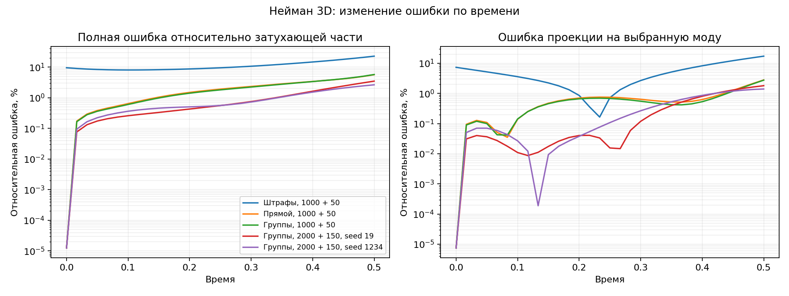

# Многомерные точные условия: результаты CUDA

Работа выполнена в ветке `codex/robin-box` на текущем стеке Torch 2.1.0 + CUDA 11.8,
RTX 4070 Ti, FP32 без TF32. Производные считались автоматически; аналитические
температуры не передавались обучению. На Mac выполнялись только CPU-проверки.

Полный математический вывод, включая согласованность рёбер, полноту конструкции,
пакетные способы и сокращение графа: [robin-box.md](robin-box.md).
Конфигурация и ограничения: [API.md](API.md).

## Что изменено

1. `hard_initial_robin` распространён на 2D–3D: пары Неймана/Робина на всех гранях,
   одно поле, постоянные коэффициенты операторов и гладкие меняющиеся данные.
2. Начальная совместимость проверяется через граничные операторы; на пересечениях
   сравниваются производные данных в направлениях соседних граней. Это семплированная
   проверка, а не доказательство тождества между узлами или существования PDE-решения.
3. Три способа вычисления одной конструкции: `eager`, `robin_batch`, `robin_grouped`.
   Подтверждённый групповой способ стал default только для явно включённого
   `hard_initial_robin`. Общий выбор ограничений остаётся `soft`.
4. При предсказании группами граф последней нормальной производной не сохраняется.
   Точные нули Неймана исключены; физические константы кэшируются по устройству/типу.
   Значения сети и её производные между шагами не кэшируются.
5. Добавлены независимые объёмный тепловой баланс, квадратура Гаусса и анализ
   затухающей части по временным слоям из уже сохранённых предсказаний.

## Контрольные обучения с одинаковым бюджетом

Начальное состояние 19; 1000 шагов Adam, 50 шагов L-BFGS; 512 фиксированных точек
латинского гиперкуба, размер пакета Adam 128; сеть 32×32×32. Для каждой задачи
способ со штрафами, прямой точный способ и групповой используют одинаковые
данные/начальную сеть. Время включает запуск процесса; ошибка — по независимой
сетке. Проценты в таблице — общая относительная ошибка температуры.

| Задача | Штрафы: ошибка / время | Прямой: ошибка / время | Группы: ошибка / время |
|---|---:|---:|---:|
| Нейман 2D | 0,4353% / 14,05 с | 0,05205% / 87,59 с | 0,05190% / 51,66 с |
| Робин 2D | 0,1951% / 13,99 с | 0,04253% / 87,48 с | 0,04368% / 51,67 с |
| Нейман 3D | 1,604% / 15,77 с | 0,2488% / 480,99 с | 0,2430% / 181,12 с |
| Робин 3D | 0,3516% / 16,16 с | 0,07038% / 483,20 с | 0,06526% / 180,59 с |

Группы сохранили качество прямой конструкции и сократили время обучения примерно
в 1,7 раза в 2D и 2,7 раза в 3D. Точные условия улучшили решение при одинаковом
числе шагов, но обучение со штрафами всё ещё дешевле. Эта таблица не измеряет
первое достижение общей целевой точности и не доказывает универсальное ускорение
точных условий над штрафами.

`boundary_rmse` стандартного бенчмарка — ошибка температуры на границе относительно
аналитического решения. Для Неймана/Робина температура не задана отдельно.
Поэтому точные условия проверяются дополнительным `boundary_operator_rmse`:
для этих обучений он примерно 2·10⁻⁷, а ошибка начального поля — примерно 6·10⁻⁸.

## Неудача короткого Неймана 3D и дополнительное обучение

Заранее заданные дополнительные пороги: общий L2 ≤ 1%, последний L2 ≤ 2%,
невязка PDE ≤ 0,02, граничный оператор ≤ 10⁻⁴, начальное поле ≤ 10⁻⁵,
ошибка относительно моды ≤ 2%, скорость нарушения баланса ≤ 0,01,
накопленное нарушение ≤ 0,005. Порог ошибки относительно моды относится ко всему
пространству-времени; временные слои дополнительно анализируются отдельно.

Короткий точный Нейман 3D не прошёл порог PDE: 0,03674 прямо и 0,03615 группами.
Остальные его дополнительные метрики прошли. Это не было скрыто общим статусом
`passed`: стандартный бенчмарк имеет более широкие пороги.

При 2000 шагах Adam и 150 шагах L-BFGS, с теми же 512 точками и групповой
конструкцией, оба начальных состояния прошли все дополнительные пороги:

| Начальное состояние | Общий L2 | Ошибка относительно моды | PDE RMSE | Нарушение баланса, RMSE | Время |
|---|---:|---:|---:|---:|---:|
| 19 | 0,1120% | 0,6729% | 0,01801 | 0,002313 | 377,09 с |
| 1234 | 0,1044% | 0,6270% | 0,01562 | 0,001669 | 377,26 с |

Накопленный дисбаланс не превышает 2,44·10⁻⁴; граничный оператор остаётся около
2·10⁻⁷. Большее обучение преодолело неудачу короткого опыта. Увеличены обе фазы
оптимизации, поэтому отдельно приписывать улучшение Adam или L-BFGS нельзя.
Новая комбинация дала более точное решение за меньшее время, чем измеренный
прямой короткий запуск; полноценная кривая времени до первой целевой точности
не построена.

## Смешанные грани в 3D

Оси x/z — Нейман, y — Робин; 2000 шагов Adam + 100 L-BFGS, 512 точек,
групповой адаптер `eb65fda`. Оба состояния прошли стандартные и дополнительные
пороги, включая независимый баланс с квадратурой Гаусса:

| Начальное состояние | Общий L2 | Ошибка относительно моды | PDE RMSE | Время |
|---|---:|---:|---:|---:|
| 19 | 0,1136% | 0,5220% | 0,01592 | 347,83 с |
| 1234 | 0,1318% | 0,6055% | 0,01846 | 347,24 с |

Граничный оператор RMSE ≈ 1,8·10⁻⁷; начальный RMSE ≈ 5,6·10⁻⁸. Скорость
нарушения баланса RMSE 0,00242 / 0,00157, накопленная ошибка 0,000259 / 0,000691.

## Что осталось на последнем временном слое

Для Неймана 3D на последнем слое нормирование всей ошибки на затухающую часть
даёт 5,65% прямо, 5,72% группами при коротком бюджете и 3,49% / 2,64% после
дополнительного обучения. Это больше глобальных 0,67% / 0,63%, потому что мода
затухает, а ошибка не уменьшается с той же скоростью.

Ошибка проекции на саму выбранную моду на последнем слое — 1,81% / 1,41% после
дополнительного обучения; оставшаяся ортогональная ошибка RMSE — 0,00281 / 0,00211.
Поэтому проблема не сводится к одному неверному коэффициенту затухания. Точность
улучшилась, но поздний слой ещё требует внимания. Эти дополнительные показатели
не были новым условием прохождения уже запущенных опытов.

Из этих результатов нельзя сделать вывод об отсутствии любого индексного бага,
но улучшение с дополнительным обучением, гладкие кривые и разные составляющие
ошибки не указывают на обязательное объяснение через `i+1`.

## Изолированный замер одинаковой сохранённой модели

Коммит `9965c07`, три повторения с обратным порядком адаптеров, синхронизация CUDA,
размер пакета 512. Измеряется невязка и обратный проход без обновления параметров.
Это отделяет стоимость вычислений от разных траекторий обучения.

| Задача | Прямой | Общий пакет | Группы |
|---|---:|---:|---:|
| Нейман 2D | 74,67 мс | 58,04 мс | 43,07 мс |
| Робин 2D | 74,45 мс | 58,07 мс | 42,98 мс |
| Нейман 3D | 429,40 мс | 218,38 мс | 159,98 мс |
| Робин 3D | 428,74 мс | 217,73 мс | 159,57 мс |

В 3D промежуточный максимум выделенной памяти: около 244 МиБ прямо,
2215 МиБ общим пакетом и 239 МиБ группами. Полностью объединённый пакет
быстрее прямого, но уступает группам при обучении и гораздо дороже по памяти.
Для 2D соответствующие значения — около 36,4 / 164,8 / 37,0 МиБ.

Значения поля и градиенты параметров совпали с контролем в пределах 4,77·10⁻⁷.
На CPU общий пакет оказался медленнее; число запусков сети само по себе не
определяет скорость. После этого результата был разработан групповой вариант.

Тёплое предсказание полного поля также измерено. В контрольном обучении для
22 599 точек 3D прямой способ занимает около 0,642 с, группы — около 0,310 с.
Холодный запуск процесса предсказания занимает около 3,0 и 2,7 с соответственно.
После сокращения графа, исключения точных нулей и кэширования констант (коммит
`eb65fda`) повторный замер на тех же моделях/512 точках: Нейман 3D — 150,39 мс
на невязку и обратный проход, 24,04 мс на предсказание; Робин 3D — 160,34 и
25,29 мс. Для Неймана это ещё около 6% и 7,5% относительно исходных групп.
Для Робина цена обучения практически не изменилась; большой выигрыш этих
дополнительных упрощений не заявляется. Значения и градиенты по-прежнему
совпали с контролем в пределах 4,77·10⁻⁷.

## Трудности и ограничения

- 27 отдельных вычислений сети плюс производные высокого порядка сделали прямую
  3D-конструкцию дорогой. Простого объединения всех строк недостаточно: оно считает
  ненужные смешанные производные и увеличивает память.
- На Windows PowerShell воспринял предупреждение Python как ошибку при
  перенаправлении журнала с режимом Stop. Запуск исправлен: предупреждения пишутся
  в журнал, а успех определяется кодом завершения и наличием отчёта. CIM-запрос
  процессов оказался недоступен SSH-пользователю; повышения прав не потребовалось.
- Трапеции сами создают часть интегральной ошибки. Квадратура Гаусса проверена
  независимо на аналитических полях, а также на прямоугольниках с разными длинами
  осей; время пока интегрируется трапециями.
- Точность граничных условий не гарантирует малую невязку PDE. Общая относительная
  ошибка на большом фоне может скрывать ошибку затухающей части. Дополнительная
  диагностика разделяет полную нормированную ошибку и проекцию на выбранную моду.
- Проверено ограниченное семейство гладких линейных операторов и аналитических
  тепловых задач. Не поддержаны Дирихле в этом режиме, `beta=0`, физический
  `heat_flux`, параметры семейства, несколько полей и пользовательские
  преобразования выходов. Результаты Windows не являются проверкой Docker.

## Исходные данные и воспроизводимость

Снимки отчётов хранят и провалы дополнительных порогов:

- `experiments/2026-10-14-robin-box-baseline.json` и `.csv` — 8 контрольных обучений,
  коммит `0023ccb`.
- `experiments/2026-10-14-robin-execution.json` и `.csv` — 24 строки изолированного
  сравнения на общих сохранённых моделях, коммит `9965c07`.
- `experiments/2026-10-14-robin-grouped-training.json` и `.csv` — 4 групповых контроля
  и 2 расширенных Неймана 3D, коммит `9965c07`.

В CSV ошибки записаны долями, не процентами. Время в секундах; память в байтах.
Файлы моделей и подробные журналы находятся на Windows внутри
`C:\Projects\pinn-runner\numerical-reports`. Граница и начальное поле задаются
в исходных задачах; аналитический ответ остаётся только в оценке.

- `experiments/2026-10-14-robin-final.json` — два смешанных обучения, финальное
  сравнение исполнения и 16 разборов сохранённых временных полей.
- `experiments/2026-10-14-neumann3d-time.png` — диагностический график.

Итоговые проверки: `python scripts/check.py --full` — Ruff, format, strict mypy
77 исходных файлов и 387 CPU-тестов, 204,66 с. Профильный Windows-набор на `eb65fda`
— 73 прошедших теста, 134,72 с: 59 CUDA-сценариев и 14 CPU-проверок отклонения/контракта.
В этой работе выполнено 16 обучений CUDA; все их результаты, включая провалы
дополнительных порогов коротких запусков, сохранены. SSH-соединения закрыты.

Дальнейшие гипотезы: отдельно сравнить больше точек с большим числом шагов;
проверить добавление PDE-точек у граней/углов и в конце времени для гладких
совместимых тепловых задач; измерить стоимость продолжения и производных сети
отдельно. Эти последующие изменения в рамках данного блока не реализованы.
