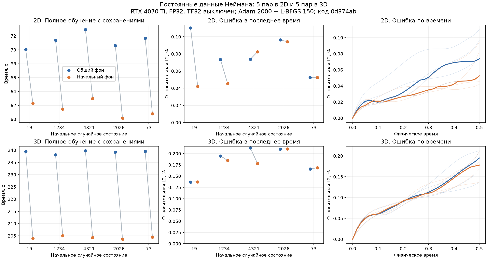

# Интеграция постоянного фона: 16 октября 2026

Предел сессии — 17:52 по времени Волгограда (14:52 UTC). Работа включает
проверку отключаемого адаптера, парные CUDA-обучения и явные граничные метрики.
Основная серия завершена: 20 обучений на закреплённом исходнике; диагностические
повторы и дополнительные проверки указаны отдельно ниже.

## Точное преобразование

Обозначим начальное поле через g, линейные граничные операторы через L_i,
их заданные значения через h_i, проекцию нейросети на однородные условия через Q.
Общий режим задаёт поле:

$$
u_\theta=b+\tau QN_\theta,\qquad
b=g+\mathcal R(h-h_0),\qquad
\tau=\frac{t-t_0}{t_1-t_0}.
$$

Здесь R — линейное продолжение совместимых граничных данных; на пересечениях
граней в него входят дополнительные линейные следы. Если все h_i явно заданы
числовыми константами, то разность h−h_0 тождественно нулевая. Поэтому:

$$
\mathcal R(0)=0,\qquad b=g,\qquad
u_\theta=g+\tau QN_\theta.
$$

Начальная совместимость по-прежнему нужна:

$$
L_i g=h_i\quad\text{на каждой грани}.
$$

Это математическая предпосылка на всей грани. Программная проверка совместимости
использует конечную выборку и не доказывает тождество произвольных пользовательских
функций во всех точках. Новый режим сохраняет прежнюю проверку и её ограничения.

Нулевой должна быть разность данных, а не сами данные. Поэтому преобразование
работает и при ненулевом постоянном потоке или Робине. Операторы в текущем
точном режиме постоянны; для зависящего от времени оператора этот вывод
по одному постоянству h неверен.

Это равенство функций при любых весах, а не новый класс аппроксимирующих
функций. В точной арифметике совпадают все существующие координатные производные,
невязка любой той же PDE и её производные по весам. Делений на нулевые временные
или граничные множители нет; ничего не кэшируется и не отсоединяется от графа.
Вычисление самой проекции Q не изменено.

Но равенство вещественных функций не гарантирует одинаковой траектории FP32:
изменение вычислительного графа может изменить порядок суммирования производных.
Малые различия могут повлиять на последующий поиск шага L-BFGS. Поэтому отдельно
проверяются математическая эквивалентность и наблюдаемая траектория обучения.

## Реализация

`InitialOnlyBackground` вычисляет начальное поле при текущих пространственных
координатах и фиксированном начальном времени. Он подключается к существующим
рецептам отрезка и прямоугольника. Новая настройка `training.hard_background`:

- `general` — прежний путь;
- `static` — требует числовых данных на всех гранях;
- `auto` — выбирает начальный фон только при таком явном контракте.

На момент начала серии основной режим — `general`. Настройка `hard_lifting`
по-прежнему выбирает способ общего продолжения. Любой `value_function`, включая
константную функцию, остаётся на общем пути. Функция не классифицируется по
нескольким пробным значениям.

В служебных параметрах модели записывается разрешённый, а не запрошенный режим
фона. Физическая сигнатура не меняется: можно использовать старые веса с другим
эквивалентным исполнителем. Проверены старые сохранения без нового служебного
поля, предсказание на новой сетке и повторное обучение после смены режима.

## Проверки перед CUDA-серией

Код закреплён на `0d374ab`. Полный CPU-набор: **562 passed / 227,60 с**,
Ruff — 176 файлов, строгий mypy — 95 файлов. На Windows — 47 профильных проверок:
36 CUDA-сравнений FP32/FP64 значений, производных и градиентов; два CUDA e2e
маршрута сохранения/предсказания/повторного обучения; девять CPU-проверок.
Аппаратный CUDA-набор также прошёл. Два коротких опыта нового CLI проверили
отдельные процессы для общего и начального фона.

Проверены смещённые неравные отрезки, ненулевое начальное время, углы,
внутренние и близкие к границе точки, ненулевые постоянные данные. На Mac
дополнительно проверено сочетание с раскрытым продолжением и направленная
производная по весам в FP64 через центральную конечную разность.

## Зарегистрированный численный протокол

По пять пар для `heat_neumann_polynomial2d` и `heat_neumann_polynomial3d`;
состояния 19/1234/4321/2026/73. 2000 шагов Adam, 150 шагов L-BFGS, 1024 PDE-точки,
сгруппированная проекция, рекурсивное продолжение, обратный проход по весам.
Срезы 0/25/50/75/100/125/150. Каждый вариант в новом процессе Python;
порядок обращается между состояниями, обновлений кода Windows во время серии нет.

В 2D пороги времени до точности: общая L2 ≤ 0,001, последняя ≤ 0,002,
PDE RMS ≤ 0,005. В 3D: ≤ 0,005 / ≤ 0,01 / ≤ 0,02. Это новая изготовленная
3D-задача без прежней полной серии; более мягкие диагностические пороги
зафиксированы до первого результата. Для подтверждения нужны два соседних
успеха; аналитическая оценка выполняется только после всех шагов обучения.

Обычные `FixedQuality`-критерии сохранены. Протокол принятия требует пройти
их на всех состояниях, исследовать любые расхождения пар, улучшить медианное
время минимум на 5% в каждом случае и не увеличить пиковую выделенную память
более чем на 10%. Старые отрицательные результаты не исключаются.
[Исходный протокол](experiments/2026-10-16-static-background-integration-protocol.json).

## Первое обнаруженное расхождение

В первых двух парах 2D после Adam наблюдались различия общей относительной
ошибки порядка 4·10⁻⁸. После L-BFGS различались веса, метрики и число обращений
к функции потерь. В обеих этих парах начальный фон дал более точное решение.
Это ещё не основание считать его лучше вообще или автоматически менять режим.

Пример seed 19: у общего пути после шага 75 метрики почти перестали меняться,
у начального фона оптимизатор продолжил снижение. Число обращений L-BFGS
к концу 150 шагов — 208 против 303. Поэтому сравнение времени при одинаковом
числе внешних шагов не является сравнением одинакового объёма вычислений.
Отдельно нужны измерения на одинаковых весах/точках и время достижения порога.

Объяснение через порядок суммирования FP32 и чувствительность поиска шага —
рабочая гипотеза, не доказанная конкретная причина внутри CUDA. Производные
проверяются независимо в FP64 и конечными разностями; по завершении очереди
будет выполнен одинаковый вход для обоих GPU-исполнителей.

На CPU при одинаковых весах и восстановленных точках получены **24 точных
совпадения из 24**: обе размерности, три состояния, 128/1024 точки, FP32/FP64.
Совпали поле, невязка, функция потерь и весь вектор градиентов. Повтор одного
исполнителя также совпал точно. Это проверка вычисления одной функции потерь,
а не повтор исторического обучения. Сырые значения сохранены в
`experiments/2026-10-16-static-background-cpu-equivalence.json`.

Почему L-BFGS может усиливать малую разницу? Он использует разности весов и
градиентов между шагами:

$$
s_k=\theta_{k+1}-\theta_k,\qquad
y_k=\nabla J(\theta_{k+1})-\nabla J(\theta_k),\qquad
\rho_k=\frac{1}{y_k^\mathsf{T}s_k}.
$$

Здесь J — та же функция потерь, а rho входит в обновление приближения обратной
матрицы вторых производных. Если скалярное произведение мало, малое абсолютное
изменение градиента может заметно изменить rho. Кроме того, поиск шага сравнивает
значения потерь и направленные производные с порогами: разница в округлении
может изменить ветвление. Это объясняет возможность расхождения, но не доказывает
его причину в данной серии. Не утверждаем ни ошибку CUDA, ни установленную
недетерминированность конкретной операции.

Допуск производных — проверка близости одного вычисления. Он не является
теоремой о близости всех последующих шагов нелинейной оптимизации. Поэтому
полные парные обучения остаются обязательной отдельной частью проверки.

## Метрики границ

Новая независимая диагностика различает ошибку температуры на стенке и ошибку
самого граничного условия. Условие Неймана не фиксирует температуру стены;
поэтому точная нормальная производная может сочетаться с ненулевой ошибкой
температуры. Явное имя `boundary_temperature_rmse` добавлено рядом с прежним
`boundary_rmse`, сохраняющим старый смысл. Физические ошибки операторов
публикуются отдельно по каждой грани, полю и типу условия.
[Формулы и выборка](boundary-error-metrics.md).

Эти изменения готовились на Mac, пока очередь работала на исходном `0d374ab`.
Состав измеряемой CUDA-серии и её критерии ими не меняются.

## Полные парные обучения: результат

Все 20 основных обучений завершены на `0d374ab`: по пять пар в 2D и 3D.
Все модели прошли неизменённые критерии `FixedQuality`. У каждого состояния
каждого режима наблюдались два соседних успешных среза времени до точности.
Ни одного неподтверждённого или исключённого состояния нет.

| Величина, медиана пяти состояний | 2D: general → static | 3D: general → static |
|---|---:|---:|
| Обучение с сохранениями, с | 71.36 → 61.46 | 239.47 → 204.27 |
| Полный процесс, с | 75.25 → 65.29 | 254.26 → 218.33 |
| Первый успешный срез с последующим подтверждением, с | 64.83 → 55.20 | 212.67 → 181.24 |
| Тёплое предсказание, мс | 26.67 → 17.68 | 190.99 → 111.75 |
| Общая относительная L2, % | 0.04264 → 0.03167 | 0.10025 → 0.09767 |
| Последняя относительная L2, % | 0.07375 → 0.05251 | 0.19479 → 0.17791 |
| Независимая PDE RMS | 0.0014573 → 0.0013639 | 0.0020939 → 0.0020487 |
| Пиковая выделенная память, МиБ | 89.08 → 88.64 | 470.71 → 469.26 |

Снижение медианного времени обучения — **13,87% / 14,70%**, времени
до наблюдаемого успеха — **14,85% / 14,78%**, предсказания — **33,71% / 41,49%**.
Пиковая выделенная память немного уменьшилась; роста выше 10% нет.
Числа относятся к разным областям измерения, их нельзя складывать.

Время обучения включает семь сохранений, но не последующую аналитическую
оценку. Полный процесс включает запуск Python, подготовку, обучение и оценки.
Время до точности определено по записанным срезам ретроспективно: это верхняя
граница момента пересечения, а не измеренный запуск с ранней остановкой.
Порог между соседними срезами не интерполируется; для подтверждения нужен
следующий успешный срез. В этой серии нет левого цензурирования.

Предсказание измерено у фактически обученного исполнителя, а качество —
отдельным физическим оценщиком `eager/general`. Три прохода прогрева, медиана
семи проходов; точки уже на GPU, пакет 2048, последний пакет неполный.
В 2D — 8959 значений, в 3D — 22599.
Это не время чтения конфигурации, загрузки весов или записи результатов.

Средние улучшения не означают улучшение каждого состояния. В 2D seed4321
ошибка последнего времени выросла на **11,60%**; в 3D максимальный рост —
**1,73%**, общей ошибки — **3,34%**. Предварительно заданная граница 1,5
для отношения ошибок пары нигде не нарушена. Медианы общей и последней
ошибки лучше у начального фона в обеих задачах.

После завершения обучения максимальная относительная ошибка временной
сетки приходится на последнее время у всех 20 моделей. Частное упрощение
фона сохраняет класс функций и само по себе не устраняет этот эффект.

На правых графиках тонкие линии — отдельные состояния, толстые — медианы.
Это описательные данные пяти состояний, не доверительный интервал.

[Все исходные срезы и метрики](experiments/2026-10-16-static-background-integration.json),
[плоская таблица итогов](experiments/2026-10-16-static-background-integration.csv).

## Почему обучение разошлось и что показала диагностика

Из 70 пар сохранений general/static веса совпали точно только в семи.
Максимальное абсолютное расхождение весов сразу после Adam — 7,15·10⁻⁷;
максимальное относительное L2-расхождение состояния среди всех сохранений —
около 2,80%. Последнее не равно ошибке физического решения. Счётчики L-BFGS
тоже могут отличаться; это не ускорение одного и того же списка операций.

Два заранее объявленных повторных обучения 2D seed19 выполнены на том же
`0d374ab` после основных 20. **Каждый режим точно воспроизвёл самого себя**:
веса, численные метрики и счётчики всех семи сохранений. Эти повторы не считаются
двумя дополнительными независимыми состояниями и не заменяют исходные пары.
[Зарегистрированный повтор](experiments/2026-10-16-static-background-repeat-protocol.json).

На `9eba331` взяты обученные общим путём веса 2D/3D seed19 после Adam и после
150 шагов L-BFGS. Для каждой модели проверены 128/1024 одинаковых восстановленных
точек, FP32/FP64, реальная `model_step` и выбранный обратный проход. Получены
**16 точных совпадений из 16** градиентов, значений, невязки и функции потерь;
собственные повторы обоих исполнителей тоже точные. На CPU ранее совпали все 24
аналогичных проверки исходных весов. Конечные разности по направлению в весах
проверены отдельно в FP64 для 2D/3D.

Эти результаты подтверждают эквивалентность проверенных вычислений, но
**не устанавливают конкретную причину исторического расхождения внутри CUDA**.
Восстановленная по seed выборка не выдаётся за записанный порядок каждой
исторической мини-партии Adam. Прогрев и размещение тензоров также могут
отличаться от исходной истории вызовов. Объяснение через чувствительность
округления и поиска шага остаётся гипотезой; недетерминированность конкретной
операции не доказана. Точное воспроизведение каждого режима само с собой
не позволяет просто списать расхождение на произвольную случайность запуска.

По этой причине в следующие отчёты добавлены отпечатки начального состояния
и фактической фиксированной выборки L-BFGS. Они не восстанавливают старые данные
и не заменяют проверку всей траектории. Хеширование находится вне измеряемого
времени обучения; пики памяти записываются до заключительного хеширования.

## Независимая проверка Неймана у всех обученных моделей

Для каждой модели взято 64 точки на каждую грань, включая начальное/последнее
время; касательные координаты находятся внутри грани. Использованы физическое
поле и обычное автоматическое дифференцирование, без аналитического учителя
и готовых правил ускоренных производных. Максимумы по всем граням пяти состояний:

| Задача | general: максимум абсолютного дефекта | static: максимум абсолютного дефекта |
|---|---:|---:|
| 2D, 20 граней каждого режима | 2,27·10⁻⁷ | 2,68·10⁻⁷ |
| 3D, 30 граней каждого режима | 2,94·10⁻⁷ | 2,31·10⁻⁷ |

Всего 100 записей граневых операторов, по 64 точки в каждой. Это конечная
проверка, не непрерывная оценка по всей границе. Условия не включались обратно
в функцию потерь: жёсткое представление сохранилось. Измеренное основное
обучение не включает эти дополнительные проверки.

## Решение по основному режиму

**Принять `hard_background: auto` по умолчанию только для `hard_initial_robin`.**
Все заранее заданные численные условия принятия пройдены на пяти состояниях
обеих задач: качество, подтверждённый порог, более 5% выигрыша времени,
ограничение памяти; медианные ошибки не ухудшились, ни одна пара не превысила
отношение 1,5. Расхождения весов исследованы отдельными повторами и проверкой
одинаковой функции потерь; битовая тождественность обучения не объявляется.

Принятие относится к точному преобразованию функции при его явных предпосылках
и проверенной численной реализации с допустимой чувствительностью оптимизатора.
Оно не означает доказанного превосходства качества на произвольной PDE.
Пользовательский физический контракт сохраняется, оптимизатор не меняется.

- Явные числовые данные всех граней → начальный фон.
- Любой `value_function`, даже фактически константный → общий фон.
- Явный `hard_background: general` возвращает прежний путь.
- Для `soft` и `hard_initial_dirichlet` основной фон остаётся `general`.
- `hard_lifting: expanded` не становится основным; прежний отрицательный
  результат этой отдельной стратегии не пересматривается.

Нового пространства признаков, изменения PDE, обратной задачи, кеширования
производных или обновления Torch/Lightning в этом блоке нет.

[Исходные диагностические результаты и XML-итоги](experiments/2026-10-16-static-background-diagnostics.json).

## Заключительные проверки и передача

- Полный CPU на принятой реализации: **588 passed / 230,00 с**,
  `scripts/check.py --full`; Ruff lint/format — 183 файла,
  строгий mypy — 98 исходных файлов.
- Быстрый набор: **544 passed, 44 e2e исключены**. Исключённые сценарии
  не считаются пройденными этим запуском; они входят в отдельный полный набор.
- Windows `0d374ab`: **47 passed** профильного набора
  (`test_static_robin_background.py`, `test_convergence_processes.py`,
  `test_static_background_runner.py`), затем **10 passed** аппаратного CUDA-набора.
- Windows `9eba331`: **57 passed**, тесты начального фона, физических операторов
  границ и одинаковой функции потерь. Это повторяющиеся профильные наборы,
  их числа нельзя складывать как количество уникальных проверок.
- Windows `da67acf`: **56 passed / 43,61 с**, `test_benchmark_fingerprints.py`,
  `test_static_robin_background.py`, `test_static_background_runner.py`.
  Из них 42 проверки используют CUDA, 14 — CPU-проверки контрактов и инструментов.
- На финальном коде дополнительно прошли четыре коротких отдельных процесса
  CLI: 2D/3D, `auto/general`, три шага Adam и два L-BFGS, семь точек.
  `auto` разрешился в `static`, начальные веса и фиксированные данные имели
  одинаковые отпечатки; контроль качества оставался `eager/general`.
  Эти короткие проверки не являются дополнительными приёмочными обучениями:
  строгий порог точности в них не подтверждён, что ожидаемо при таком бюджете.

Всего в исследовательской серии **22 полных обучения**: 20 основных и два
повтора. Первоначальный короткий CLI-контроль и четыре заключительных процесса
учитываются отдельно. CUDA запускалась только на Windows через SSH из
`C:\Projects\pinn-runner`, с временными файлами и кешами внутри проекта.
Torch 2.1.0+cu118 и Lightning не обновлялись.

Математические пояснения и фактические результаты перенесены в
[памятку разработки](CHAT_DEVELOPMENT_HANDOFF.md) и
[памятку преподавателя математики](CHAT_MATH_TUTOR.md).
TASK-21 остаётся в работе: этот блок не закрывает полный профиль CUDA-ядер
и все исторические сравнения других вариантов. Новые признаки сети пока
не реализованы; им потребуется отдельная сигнатура представления и проверки
третьих граничных производных по полиномиальному контролю.
